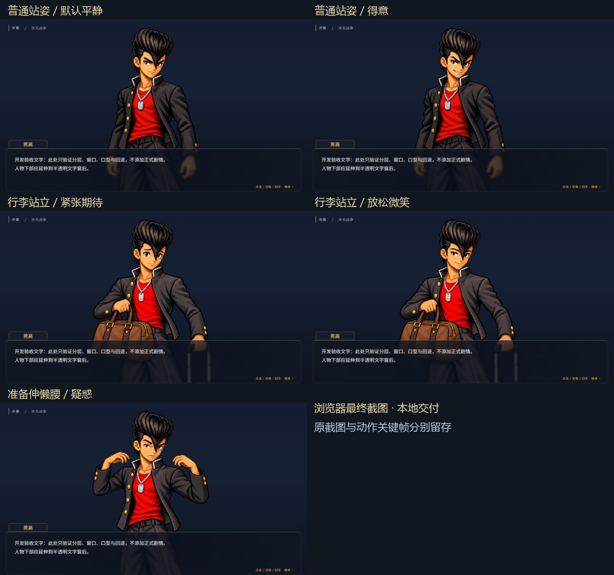
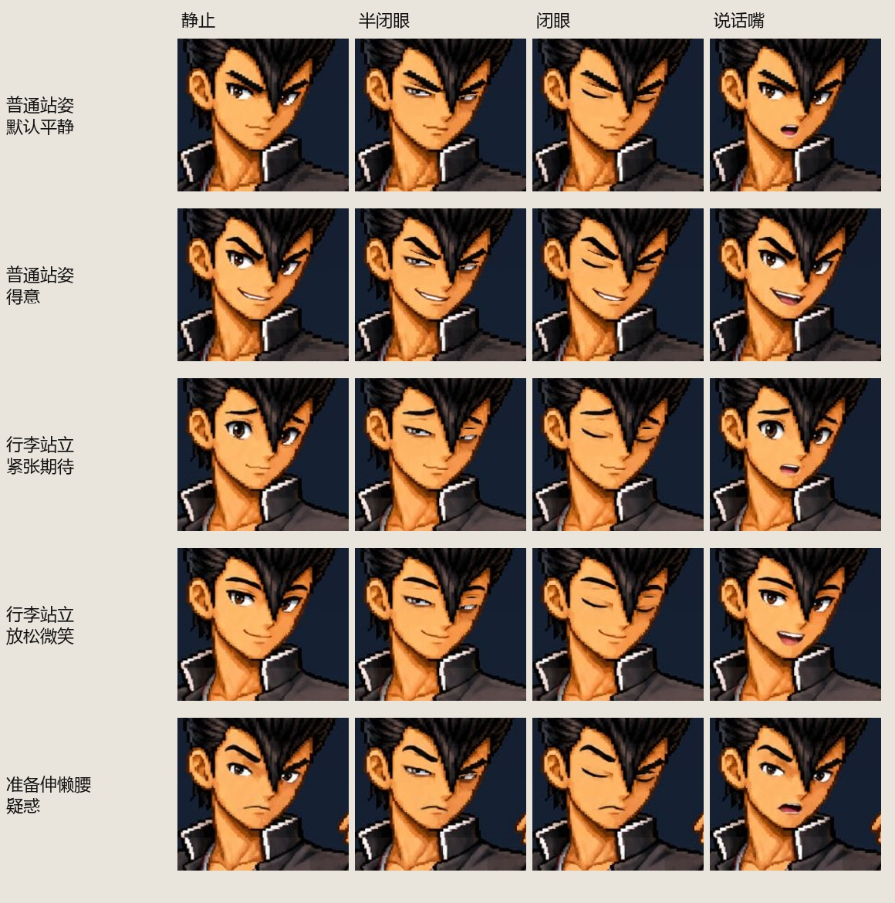
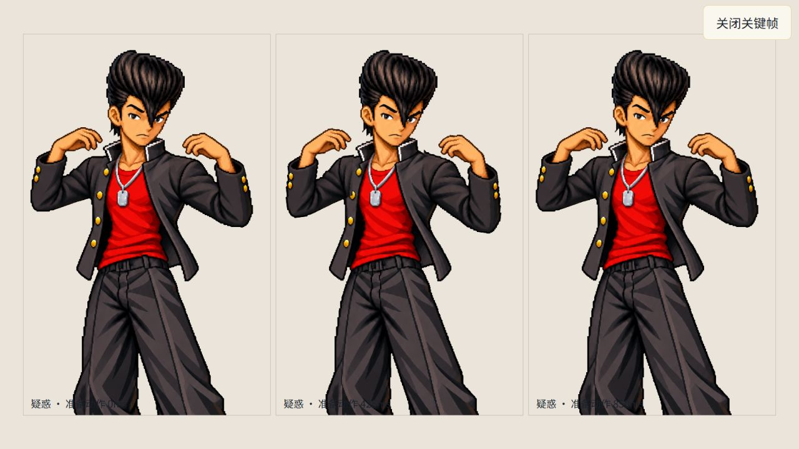

# 男高三姿态、五组合视觉样板验收

日期：2026-10-23。工程：`E:\笔记\次元战争设定\游戏文件`。

本阶段完成五个原创组合的美术与正式配置，均通过本轮逐项视觉复核并批准，等待维护者查看。只本地交付，没有提交、推送或部署。范围为序幕至第一幕；未扩大其他角色或全部姿态。

## 1. 基线及本阶段成果

开工HEAD为`cd9613a6ee0a0b5673869520946bb27b84ab8474`，已存在上一轮未提交的窗口、稳定DOM、图层复用、预解码、过期请求保护、静态回退、眨眼／呼吸／口型与动作控制。实际开工为25个测试文件362项通过，原v1／v2五配方均未批准。上述框架不重新计作本阶段从零成果。

本轮先以普通平静统一母版解决比例、拼合与轮廓，再制作真实表情差分、双行李和准备动作。正式配置精确匹配原asset／pose／expression，不改剧情JSON或原文姿态。批准记录为[review.json](../art/hero-layered-v3/review.json)，记录逐项顺序、依据与限制；不是因为文件解码成功统一启用。

## 2. 五组合逐项结果

| 组合 | 美术复核 | 批准 | 正式剧情生效 | 最终窗口图 |
|---|---|---|---|---|
| 普通站姿／默认平静 | 通过；统一母版先行基准 | 是 | 仅开发样板，原文无此组合 | [深底](verification/hero-visual-samples/calm-final-dark.jpg)／[浅底](verification/hero-visual-samples/calm-final-light.jpg) |
| 普通站姿／得意 | 通过；眉眼、嘴角及说话嘴独立 | 是 | 仅开发样板，不替代P003坐沙发 | [深底](verification/hero-visual-samples/proud-final-dark.jpg)／[浅底](verification/hero-visual-samples/proud-final-light.jpg) |
| 携带行李、站立／紧张、期待 | 通过；袋、箱及握持完整 | 是 | P001，P002原表情更新前 | [深底](verification/hero-visual-samples/nervous-final-dark.jpg)／[浅底](verification/hero-visual-samples/nervous-final-light.jpg) |
| 携带行李、站立／放松、微笑 | 通过；沿用相同双行李姿态 | 是 | P002原SHOW更新后 | [深底](verification/hero-visual-samples/relaxed-final-dark.jpg)／[浅底](verification/hero-visual-samples/relaxed-final-light.jpg) |
| 准备伸懒腰／疑惑 | 通过；整臂肩部小幅动作 | 是 | A006，A007继承 | [深底](verification/hero-visual-samples/puzzled-final-dark.jpg)／[浅底](verification/hero-visual-samples/puzzled-final-light.jpg) |



各表情开眼、半闭、闭眼和说话嘴都在真实LayeredFigure中固定时刻采样；下图只对实际截图做同一矩形裁切、缩放和拼排，没有重绘五官。



准备动作0／425／850ms使用真实组件采样。左右整臂分别为0°／±7°／0°，850ms动作结束。检查手掌、前臂、衣袖、肩部均连续，未出现重复手臂或悬空碎片。仅表现“准备”，不追加完整伸展。



## 3. 素材与制作记录

- 运行目录：`public/assets/portraits/hero-layered-v3/`，33张PNG，共2,707,168字节，另有`registration.json`。画布统一1024×1536，人物锚点[512,1536]，完整画布偏移[0,0]。每帧来源、掩膜、包围盒和SHA均登记；层级、motion和pivot在`src/game/visual/hero.ts`。
- 母版目录：`art/hero-layered-v3/masters/`，20张PNG，包括18次内置imagegen输出及2张编辑／机械整理参考。完整生成提示词见[imagegen-prompts.json](verification/hero-visual-samples/imagegen-prompts.json)。素材只参考本项目男高造型，保留黑飞机头、制服、红内衫、配饰及像素风，未使用原作素材。
- 普通站姿五层：身体／衣物（双臂保留一体）、头部底板、眉眼、嘴、顶发。后部头发与头底一体，只有顶发cap独立轻摆；不宣称后发与所有衣摆都独立模拟。
- 行李六层：增加左手／前臂／行李袋握持组，与身体同步呼吸；右手与拉杆箱留在身体层。完整原画同时有袋和箱，实际腰上构图让下部自然延伸到窗后或画面外。完整浅深合成图可查看[nervous-composite-light](verification/hero-visual-samples/nervous-composite-light.jpg)及[dark](verification/hero-visual-samples/nervous-composite-dark.jpg)。
- 准备姿态七层：补绘遮挡衣物后的无臂身体，加左右完整手臂，肩部pivot为[350,405]、[633,410]。分肘拆分产生不必要接缝，已否决并保留`segmented-review/`四张部件；单包候选也保留`single-bag-review/`两张，未删除失败依据。
- 五种表情各有开眼／半闭／闭眼眉眼、静止嘴／说话嘴，共25张五官帧。眨眼保留各自眉形，嘴型保留对应情绪；不是五个名称共用一张脸。
- 机械处理由`tools/prepare-hero-samples.py`复现：新生成母版保留原字节，运行帧alpha≥220保留、其余透明，保留主体连通区，透明RGB清零，固定坐标掩膜裁切。未缩放独立手臂硬拼，未用程序重绘替代人物原画。全33帧逐像素alpha与透明RGB核对，通过浅深底、实际窗口及动作关键帧复核，不只检查四角。
- 呼吸为身体±1.3px、头部及五官±2.1px的小幅位移，顶发独立轻摆；[呼吸上点](verification/hero-visual-samples/luggage-breath-up.jpg)／[下点](verification/hero-visual-samples/luggage-breath-down.jpg)中握持组与身体变换相同。没有用整图缩放冒充身体变形。

## 4. 正式剧情接入及浏览器范围

根路径隔离origin为`http://127.0.0.1:43856/`，本轮没有清理用户5173或正式网站的存档。

| 检查 | 本轮实际操作与结果 | 证据 |
|---|---|---|
| 五组合画面／差分 | 开发页实际按钮切换，五项浅深背景、半闭／闭眼／口型均解码并显示；各组合无明显光晕、残点、比例断层或切换跳位 | browser-five-samples.json，五项截图及关键帧图 |
| P001→P002 | 正常游戏菜单→地图→奶奶家卡片进入；P001为紧张双行李，P002先继承，原SHOW后才微笑。最终双行李版本另从合法P001检查点继续，并在生产子路径从新档重复正常流程 | [P001](verification/hero-visual-samples/story-p001-final.jpg)、[P002](verification/hero-visual-samples/story-p002-final.jpg)，browser-normal-p001-p002.json |
| 真实刷新／继续 | P002返回地图后刷新，主菜单继续恢复P002场景头；紧张行李先显示，再按原顺序更新微笑。场景头恢复不是保存逐字光标 | browser-normal-p001-p002.json，browser-project-path.json |
| A006正常姿态变化 | 使用既有`/tests/save-storage.html?case=v1-a005`替换IO检查点，从A005通过真实键盘正常进入A006，采到准备动作接近±7°及疑惑表情 | [A006](verification/hero-visual-samples/story-a006-from-a005.jpg)，browser-act1-controlled.json |
| A007继承与选择 | 从A006正常推进A007，仍为准备疑惑；四项启用状态[false,true,false,false]，第二项正常进入A008 | [A007](verification/hero-visual-samples/story-a007-inherited.jpg)，browser-act1-controlled.json |
| A007返回地图／继续 | 点击真实返回地图、学校地点、继续卡片；从A007场景头复建，整臂为0°，不补播动作 | [恢复](verification/hero-visual-samples/story-a007-restored.jpg)，browser-act1-controlled.json |
| A010原覆盖行为 | 另用受控v1-a010检查点，点击回班，执行原SET、显示完整原说明，再回同一选择，场景仍a010、不进a016 | [完整说明](verification/hero-visual-samples/a010-return-note.jpg)，browser-a010-controlled.json |
| 多人强调与站位 | 男高／同学甲同槽位置始终572／708；说话男高亮度1、z4，另一人0.8、z1；场外台词时两者0.8、z1，不新增或挪动演员 | browser-brightness-final.json |
| 口型 | 开发页台词逐字开合；补全、完成、心声、旁白、舞台说明及场外台词均闭嘴；隐藏、道具等门控保留自动回归 | browser-program-final.json，原视觉规则测试 |
| 快速更新与延迟 | 延迟1.2秒时旧微笑画面保留，连续切得意→紧张；最终只显示最新紧张，旧成功不能覆盖 | browser-program-final.json |
| 加载失败／缺素材 | 受控半闭眼帧失败，回退原静态asset，未把静态asset标坏；未覆盖坐姿仍静态并明确诊断 | [失败回退](verification/hero-visual-samples/controlled-layer-failure.jpg)，browser-program-final.json |
| 实例复用 | 实际DOM检查root／body／head／eyes容器及未变化差分引用均相同。异步第一次读取尚未完成，最终记录五项均true | browser-program-final.json中最后一条reuse记录 |
| 离开与旧请求 | 有8个延迟图片请求时释放，舞台立即移除；完成后仍无舞台，帧请求计数1283不再增长 | browser-lifecycle.json |
| 动画不保存 | P002静置动画前后DOM暴露的saveJson、saveRequest=1、saveStatus及保存时间一致；纯视觉查询不改变state／flags／RNG另由自动回归确认 | browser-animation-storage.json |

受控A005／A010页使用Map假存储和既有替换IO，不注入GameState、不改血、不跳场景指令，不接触用户localStorage。`browser-act1-controlled.json`记录v1原串一致。**这些受控检查点验证不等于从新档完整玩完七关**；A007只实测返回地图后继续，没有在该假存储页刷新（刷新会重建fixture初始A005）。真实刷新是在P002及生产子路径完成。

隐藏DOM仍可保留旧演员实例；原始JSON中的演员数组不代表全部在画面可见。可见性与五槽由现有播放器控制，没因说话自动显示／隐藏角色。

## 5. 工程检查与正式子路径

| 命令 | 实际结果 |
|---|---|
| `npm run typecheck` | 通过，strict保持 |
| `npm test` | 27个测试文件，409项通过；保留开工362项，新增47项 |
| `npm run build` | 通过，73模块；JS159.88kB／CSS18.06kB（Vite输出口径） |
| `npm run build -- --base /dimensional-war-game-source/` | 通过，项目路径JS159.94kB／CSS18.06kB |

完整输出：[commands.log](verification/hero-visual-samples/commands.log)、[project-build.log](verification/hero-visual-samples/project-build.log)。

新增测试为33张真实PNG的全画布透明／坐标／SHA检查，以及14项五配方、独立批准、情绪差异、握持同步、动作、真实剧情与正式base验证。原“未批准／未齐备不能启用”断言用只读历史目录fixture保留；旧分肘数学断言用明确分肘fixture保留，未为新素材删减防护。没有新增运行时或开发依赖，src／tools代码均不超过400行。

生产预览：`http://127.0.0.1:43857/dimensional-war-game-source/?seed=0`。

- 33张运行帧在该HTTP子路径下全部200，Content-Type为image/png，下载字节的SHA与本地登记逐一一致；入口JS／CSS同样200且含正确base，见[asset-path-checks.json](verification/hero-visual-samples/asset-path-checks.json)。
- 实际生产浏览器从无档主菜单→地图地点→首关→P001→P002，全部新图片成功解码；微笑切换、返回地图、刷新／继续场景头均通过。截图[项目路径P001](verification/hero-visual-samples/project-path-p001.jpg)／[P002](verification/hero-visual-samples/project-path-p002.jpg)，详细记录browser-project-path.json。
- dist没有tests、art、docs、source或tools目录；母版、故障页及验收证据没有进入生产入口。本轮最终dist保留正式项目路径构建，root开发服务器仍正常。
- 开发页、正常页、受控A005、受控A010及生产页收集到的console error均为0。现有背景、奶奶／其他角色、音频缺绑定和未覆盖姿态警告继续保留；正常页／生产页各6条记录含刷新后的新会话重复，不能当成6个新缺口。没有本轮新素材404。完整日志见browser-console.json；受控故障页将预期诊断写在开发备注，不伪称没有发生故障。

## 6. 完整盘点与剩余范围

重新只读核对：**19种姿态、24种表情、25次SHOW／更新**，原表述、来源文件及行号、场景／节点、继承组合、素材映射和状态均见[最新盘点](verification/hero-visual-samples/inventory/hero-inventory.md)及同目录JSON。没有覆盖历史盘点。

本轮正式新覆盖原文3次明确更新：p001:2、p002:5、a006:2，以及P002、A007相关继承。普通站姿不在19种原文姿态内，平静默认也不是新增剧情；得意站姿开发样板不算P003坐姿完成。原文中的行李站立、准备伸懒腰两种姿态在对应表情组合完成，其他17种姿态仍未覆盖：

| 待制作原文姿态 | 场景 |
|---|---|
| 坐在沙发上 | P003 |
| 整理行李 | P004 |
| 散步、观察四周 | P005 |
| 战斗后喘息 | P007 |
| 刚跑回家、呼吸急促 | P008 |
| 躺在床上、望向天花板 | P009 |
| 躺在床上、刚醒 | A001 |
| 飞奔、手里攥着水煮蛋 | A002 |
| 叼着面包、跑进校门 | A003 |
| 站在讲台前、拿着白板笔 | A004 |
| 拎着书包准备落座 | A005 |
| 自然跟随 | A008 |
| 停步观察围栏 | A009／A010继承 |
| 推开铁皮小门、准备进入 | A011 |
| 持剑、准备保护虚拟主播 | A013 |
| 战斗后疲惫、扶住虚拟主播 | A014 |
| 抱着虚拟主播、疲惫 | A015 |

24种原文表情中，本轮覆盖匹配姿态的“紧张、期待”“放松、微笑”“疑惑”三种。其余21种原文组合尚未合格交付：“得意”“热血、得意”“怀念、轻松”“轻松、准备出门”“好奇”“认真、出头”“疑惑、警惕”“装作平静”“期待、认真”“困倦、慌张”“自信、急着出门”“着急”“匆忙”“自信、兴奋”“期待”“好奇、友善”“兴奋、好奇”“被吸引、犹豫”“震惊、警戒”“麻烦、担心”“尴尬、担心”。同一表情文字出现在未覆盖姿态时仍不能借样板冒充完成。

## 7. 保护与逐文件清单

以开工快照451份实际文件为基准（包含上轮未提交成果），本轮只修改其中12份授权文件，**439份保护文件逐项SHA一致，删除0，HEAD未变**。source四原文、剧情三JSON、导出器、自动问题清单、战斗／AI／配置、地图／关卡／存档、依赖及历史验收均保护。原hero.png、v1／v2候选及上轮已经修改的图层／动画框架也与开工字节一致。

前后逐项：[before.json](verification/hero-visual-samples/before.json)、[after.json](verification/hero-visual-samples/after.json)。关键7份SHA-256均未变：

| 文件 | SHA-256 |
|---|---|
| source/data/hero.md | dfad52adf111217b4481a99828d346bb3d4dd6a3b2cdd513b0f3033bebda95cc |
| source/data/org_grunt.md | 6c2c331ae4f919aec3080c96eb1b970ebc2a9c166274b873a6fda58bfc1134f8 |
| source/story/act1.md | 2d322c786a744cad4912f098523a9ad61955fc1b59040a0dc5ff08f08921a3bf |
| source/story/prologue.md | aad4cc222e351fe389d9a0164138ec9168b6cf1f9032fa4bdd21479dbfe597dc |
| src/content/act1.json | b835a2ddd354a53bed9aa14489bfe90f1accf5821019b3c94388c35719992bcd |
| src/content/index.json | a6ae3ad75097e31f89561601750275244829758bb5091b5f139cdad615eac532 |
| src/content/prologue.json | e270bee77596a9662445ce87c9bd09b4be4386780568ae368ff24184683be10a |

实际工程新增179、修改12、删除0；工程外仅修改用户指定的`游戏机制/对话与动态立绘.md`一份。完整179个新增路径及12个修改路径见[逐文件清单](verification/hero-visual-samples/file-changes.md)／[机器可读清单](verification/hero-visual-samples/file-changes.json)。新增包含运行PNG／登记34份、母版／失败部件／批准27份、测试／fixture／工具8份、本报告1份及证据109份。dist为Vite派生产物，另有本轮root与子路径两次构建；.git、node_modules、两个未操作的历史发布工作目录和Python缓存不计源码新增。

修改的12份是README、docs任务书／决策／实施规格／参考研究、hero.ts、resolve.ts、portrait-browser.ts、visual-rules.test.ts、visual-loading.test.ts、visual-refresh.test.ts及audit-hero-presentation.mjs。新工具check-hero-samples.mjs按本轮独立快照复核，不运行剧情导出或覆盖历史验收。

## 8. 本地查看与明确未验证项

已保留开发43856、子路径生产预览43857服务。打开[五组合样板](http://127.0.0.1:43856/tests/portrait-presentation.html)，使用左上控件逐项切换、固定眼睑／嘴型、浅深背景、三动作关键帧及受控故障；F2隐藏工具。该页不进入正式构建，也不读写正式存档。

如服务已停止，在工程目录分别运行：

```powershell
npm run dev -- --host 127.0.0.1 --port 43856 --strictPort
```

```powershell
npm run build -- --base /dimensional-war-game-source/
npm run preview -- --host 127.0.0.1 --port 43857 --strictPort --base /dimensional-war-game-source/
```

生产预览[正常入口](http://127.0.0.1:43857/dimensional-war-game-source/?seed=0)已有本轮P002验收档，点击继续从场景头开始。不同主机／端口与正式网站存档各自独立，没有清档或增加云同步。`/tests/save-storage.html?case=v1-a005`明确是开发服务器受控检查点，不是正常新档入口。

本轮**没有重新手动通关七关、两场战斗或复测M2 seed42整场**，这些既有规则／回流由保留自动回归验证，历史浏览器证据不挪作本轮结果。未在生产子路径通过UI逐项查看全部五组合，开发页已实际看全五项，生产端33帧已逐一HTTP核对。没有更新正式网站，因此也没有宣称线上美术已经生效。其他角色美术、其余17姿态及21种未匹配原文表情仍是后续需求。
