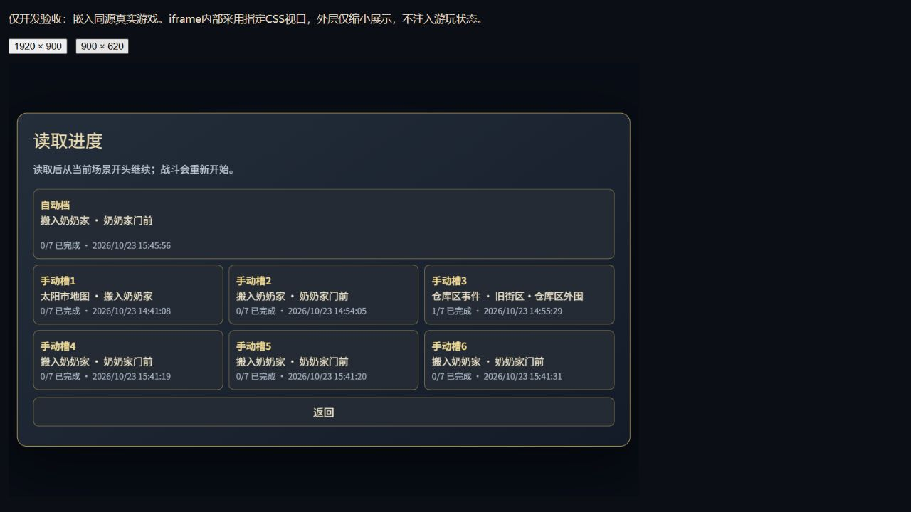
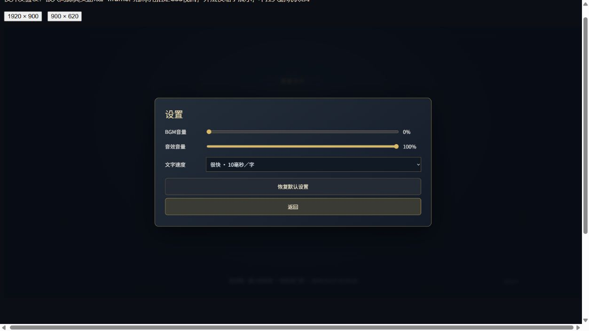
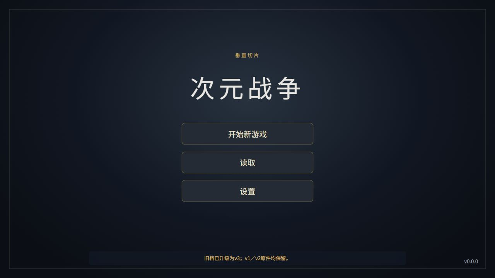
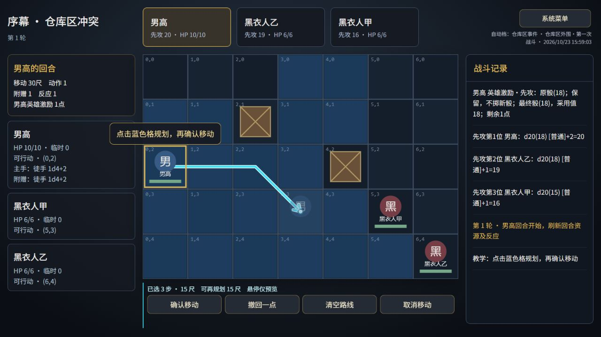

# 主菜单、多存档与设置 · 独立验收

日期：2026-10-23。实现基线`493d12952ef1a14c974b3c2d9e121d98e0ce47c7`，main。文档窗口已有7项说明变更在开工快照中保留，未重置或回滚。此次不新增素材、依赖或剧情，不创建Sites。

## 工程检查

| 检查 | 本轮实际结果 |
|---|---|
| npm run typecheck | 通过 |
| npm test | 30文件465项通过；原27文件409项断言未修改，新增56项 |
| npm run build | 通过，根路径产物 |
| npm run build -- --base /dimensional-war-game-source/ | 通过，正式项目路径产物 |
| 文件限制 | strict保持；代码无any逃生门、无超过400行；依赖与lockfile哈希不变 |

原始命令输出见[checks.log](verification/menu-save-settings/checks.log)。构建只包含正式HTML、bundle及运行素材，不包含开发验收页、source、文档或证据。最终子路径JS为`index-CzWEFOMr.js`，CSS为`index-B6od4YuH.css`；对应SHA在after.json。没有运行剧情导出。

## 实际交付

- 主菜单竖排开始新游戏／读取／设置。空档可看七空槽；新游戏成功写入后才切初始地图。有进度先确认，取消不变；手动槽、设置、旧v1／v2原件保留。
- v3一自动档、六手动槽，手动三列两行。空槽直接保存、覆盖先确认；读取准确使用所选档的flags／关卡／检查点，原槽不改，允许回退。自动档不修改手动槽。
- 系统菜单统一覆盖地图／剧情／正式战斗，暂停文字、AI、开场／移动计时，保留原激励／反应／RNG等待；底层inert且纯规则拒绝推进。Esc、Tab约束与回焦有效。
- BGM、音效音量与五档文字速度即时应用，独立写设置键。用户音量乘淡入淡出包络，换曲／会话重建不复位为65%。改速保留原文本与等待token。坏设置和写失败明确反馈。
- v1／v2只读升级，坏v3不静默回退，单坏槽不清空其他槽。Web Locks内校验活动身份、目标指纹和请求归属。明确新游戏／选槽读档换身份，旧窗口暂停；接受当前活动运行不再次抢占身份。

## 浏览器实测：隔离真实存储

根开发origin为`http://127.0.0.1:43910/?seed=0`，生产子路径预览为`http://127.0.0.1:43911/dimensional-war-game-source/?seed=0`。均独立于维护者正式域名，未清理其存档。

| 实际操作 | 结果与证据 |
|---|---|
| 空档菜单、设置、开始新游戏 | 三入口可用；设置独立保留；成功建立自动档后进地图 |
| 真实六槽逐一保存、刷新、读取 | 六槽均保持；覆盖取消不改，确认仅改目标；browser-main-flow.json、six-slots.jpg |
| 从新档正常完成P001–P004 | 第一关正常结束回地图，进度1/7；完成关不可重玩，仓库显现，再正常进入P005；正文及节点操作记录在browser-main-flow.json |
| 读较早手动槽 | 从P005／1关完成回退到地图／0关，仅显现奶奶家；未被mergeV2推回未来 |
| 新游戏取消／确认 | 取消原容器不变；确认auto清到0关，六槽与设置保留 |
| P001部分文字中打开系统设置 | 文本与waitToken不变，100→10毫秒只改后续计时；关闭原等待继续 |
| BGM当前音量 | DOM实际音量从1到0，包络=1且设置为0时持续静音；换曲及淡变自动测试通过。浏览器检查的是音频实例和播放状态，未把此记录称为人工听音鉴定 |
| 同源真实窗口A／B | 分别写槽4与槽5都保留；同槽6先后确认，后者提示目标更新且必须再确认；新游戏后旧窗口暂停。browser-multi-final.json、two-window-conflict.jpg |
| 焦点 | 设置Esc回设置入口；读取Esc回读取入口；Tab从最后返回绕至自动槽；browser-focus.json |
| 子路径生产预览 | 主菜单→地图→地点浮窗→P001→手动槽1→刷新→读取成功，男高9层帧全部complete、naturalWidth1024，BGMplaying。browser-production-path.json |

### 两场正式战斗与选择（受控检查点，不是新档全流程）

开发专用`/tests/save-storage.html`替换存储IO，不读取或改写真实localStorage。各case先生成合法旧档，按正常菜单读取并从场景头通过真实Enter推进，未注入GameState、改血量或一键胜利。

- P006：旧v1成功写v3后才提示升级；从原文进入真实教学战。英雄激励先攻待定时进入设置再返回，battle token／RNG／日志不变。手动保存后读取先回P006第一段，再重新开战。
- P006：选真实路线到(3,3)，点击确认后立即开系统，真实pendingMove路径与位置在菜单中不变；关闭后走完剩余路径至(3,3)，移动15尺。没有预扣未执行步骤。
- A014：从场景头原文进入黑色人形战；大师之剑与5临时HP保留。系统菜单内token不变；手动档读取先回“战斗界面切入。”，再正常重新开战。结束回合后在敌方行动期间开菜单，进入设置后token不变。
- A007：读档恢复四选项，仅虚拟主播可用；手动存读后仍如此，正常选择进入A008且记录原flag。
- A010：回班选项执行原SET，显示唯一允许的原说明，再返回同选择；不跳A016、不通关。此例外不当作meta泄漏。
- 本轮没有重新手动打赢两战或通关七关；两战胜利CALL回流、A014战后四段与SET、七关25场161段顺序、男高及移动规则由原自动回归保持，不将单测冒充本轮浏览器胜利。

战斗证据见browser-battles.json与battle-save.jpg；选择见browser-choices.json。

### 故障与旧档专项（受控IO）

- 单坏手动槽不可读，有效槽仍可加载，坏值原样保留。
- 坏容器取消0写入，明确新游戏确认才建立新v3；没有回退旧档冒充成功。
- 读失败准确提示，解除故障后可重试。写失败不激活新游戏，解除后成功；迁移失败0写入、不宣称成功，解除后升级成功。
- 坏设置只使用默认且提示，尚未操作时0写入；恢复默认仅写设置。设置写失败仍本页生效并提示未持久保存。
- v2带前后空白原串升级后保持逐字一致；v1原串亦一致。迁移竞争采用另一窗口已建立的有效v3，不重复写；竞争坏v3保留并提示。
- 测试中所有写入键均限dw.save.v3／dw.settings.v1，v1Unchanged与v2Unchanged均为true；详见browser-faults.json。自动测试另覆盖锁内旧请求、过期结果、重复点击与跨运行冲突。

### 尺寸与可访问操作

浏览器viewport覆盖接口调用后，真实DOM仍为1280×720；先前名含1920／900的普通截图**不作为对应尺寸通过证据**。改用仅开发页`/tests/menu-layout.html`：同源真实游戏运行在1920×900或900×620的iframe内容视口，外层只缩小展示，不改状态。独立记录browser-layout-actual.json：大视口dialog920×428在边界内；小视口dialog876×476.8在边界内，自动档一行、六手动槽三列两行，Esc回读取入口。小视口没有溢出，滚动容器保留。

浏览器控制台见browser-console.json：本地7个验收标签均无error；保留既有缺素材／未覆盖组合的去重warn，不清零内容诊断。音效目前无正式绑定素材，浏览器未做真实音效听音；当前／后续实例音量由替换Audio自动测试验证。借机等待的模态暂停保留由规则测试覆盖，未额外用本轮正式浏览器触发男高借机弹窗。

## 保护与文件清单

开工before.json含599文件（包括文档窗口尚未提交的说明），允许本轮变更清单外584文件SHA256全部一致。source全部原文、三份剧情JSON、导出器、自动问题清单、原测试、既有素材、战斗内核／数值／AI、地图／关卡／原存档算法及历史验收未修改。campaign仅新增系统模态拒绝门，不改战斗规则。

完整增改删与新证据见[file-changes.md](verification/menu-save-settings/file-changes.md)，最终哈希和dist对应见[after.json](verification/menu-save-settings/after.json)。删除0。没有提交node_modules／dist／本地发布目录或凭据；没有写工程外正式设定。

## 启动、正式发布与限制

开发执行`npm run dev`；测试入口仅开发服务器可用。子路径生产预览需先`npm run build -- --base /dimensional-war-game-source/`，再`npm run preview -- --base /dimensional-war-game-source/ --host 127.0.0.1 --port 43911 --strictPort`。

正式网址：[次元战争](https://yeklongdi.github.io/dimensional-war-game-source/)，公开仓库[yeklongdi/dimensional-war-game-source](https://github.com/yeklongdi/dimensional-war-game-source)，main。复用现有Actions，无force push或可见性变更。下列发布回执将在实际成功后补入，不以本地构建替代正式成功。

维护者正式站发布前记录为P006，flag_prologue_p005_01=true、完成prologue_01，savedAt=1792665979553（online-before.json）。正式验收不会开始新游戏或清理该档。新旧域名、localhost及端口的存档相互独立，不会跨设备同步。

### 正式发布回执

- 功能提交`69212d022bddfaa2228aedbd4ea8451c56a9a0ae`已正常推送main。[Actions 39921309077](https://github.com/yeklongdi/dimensional-war-game-source/actions/runs/39921309077)明确completed／success：build29秒，deploy9秒；远端重新执行npm ci、typecheck、465项测试及正式子路径构建。actions-feature.json保留原结果。只有Ubuntu运行镜像迁移通知，无失败。
- Pages API返回正式https网址、build_type=workflow、https_enforced=true。无需GitHub登录即可加载游戏；此次没有登录流程或账号系统。
- 正式站初次加载完成v2→v3，旧auto快照字符串与发布前saveJson**完全相同**（包括原savedAt）。online-migrated.json记录对照；此比较是正式UI可见的合法快照，不冒称已从浏览器直接读取并哈希旧localStorage原串。旧原始串只读保护由代码、自动测试及受控逐字对照证明。
- 真实线上操作：读取面板一自动六空手动槽→确认原auto→P006原文→教学战；先攻激励等待内打开系统设置、返回后保留原骰；正常选(3,3)移动路线、显示确认及终点虚影，再确认执行；系统返回地图仍保留P006检查点，仓库浮窗显示“继续关卡”；刷新回主菜单仍能读取原P006。未触碰新游戏、未写线上手动槽、未改维护者设置。
- 正式站三按钮、设置、地图、剧情、战棋和移动规划均有截图／DOM证据（online-browser.json、online-main-menu.jpg、online-settings.jpg、online-movement.jpg）；控制台无error。沿用既有缺素材warn。未在线完整通关七关、未在线打赢两战，本轮不作此声明。
- 静态产物60文件全部HTTP200且SHA256与本地dist逐项一致，结果见online-http.json；不将网络资源校验等同于游玩所有分支。

发布证据与本验收说明随后以文档提交同步同一main，不改运行代码或产物；本页和release.json登记实际已成功的功能发布，文档同步提交的最终Actions与远端一致性在交付消息中报告，避免记录文件自身提交哈希的循环依赖。
