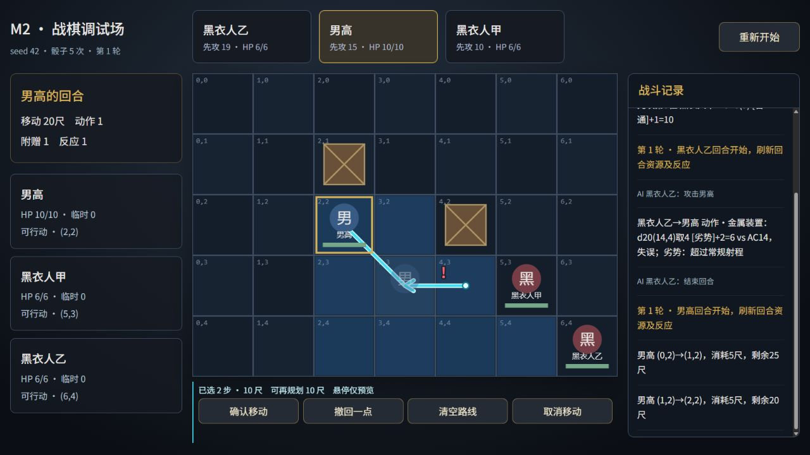

# 战棋移动路线、终点虚影与拐点规划 · 实装验收

日期：2026-10-21（Asia/Shanghai）。工程：`E:\笔记\次元战争设定\游戏文件`。

本记录属于实现窗口。用户已明确授权开发、测试和浏览器验收；前一窗口“只改文档”的职责说明结束。M0–M4及大地图历史验收保持原样。

## 1. 基线、命令与保护

开工实际核对：仍为单击目标立即移动，未初始化Git，类型检查及17个测试文件、242项测试通过；上一轮106份保护文件和原Excalidraw一致。

当前结果：

| 检查 | 结果 |
|---|---|
| `npm run typecheck` | 通过，strict保持开启 |
| `npm test` | 19个测试文件、285项全部通过；新增43项，原242项断言未修改 |
| `npm run build` | 通过，63个模块；生产预览已用于真实存档恢复验收 |
| 代码约束 | 87份TS／MJS代码均未超过400行；本轮代码无any，无新增依赖 |
| 保护哈希 | 158项全部一致，详见证据中的protected-before／after.json |

命令原始输出见[commands.txt](verification/movement-preview/commands.txt)，检查汇总见[checks.json](verification/movement-preview/checks.json)。PowerShell按typecheck→test→build逐条执行，前项失败时不进入下一项；中途测试发现的固定BFS预期问题已修正新增样例，没有修改原规则。

保护集合包括全部source、三份剧情JSON、导出器、自动问题清单、旧验收及证据、原战斗数值／地图／AI／借机资格／伤害／激励／移动内核、保存模块和依赖配置、public原素材，以及工程外指定规则与正式设定文件。未运行剧情导出，不补写剧情，不修改工程外文件，不初始化Git或推送。

## 2. 实现与规则测试

- `Command.move`增加可选只读path。没有path仍用原BFS；提供时整条校验，不重新寻路替换。校验邻接、整数坐标、地形、占格、不可穿角和总预算，允许非空回头及循环。接受后复制数组和坐标，继续交原pendingMove逐格执行。
- 必经点每段使用原固定顺序BFS，预览与确认共用结果。原BFS可能先斜走再返回同一行；没有为箭头美观修改实际走法。
- GameState草稿绑定run、战斗token、行动者；正式战斗与独立调试共用纯转换。悬停、选点、撤回、清空不执行规则，不改变BattleState、RNG、日志、教学计数、flag或保存次数。
- 确认只提交已点击部分；之后展示读取真实剩余移动。虚影是Canvas圆形棋子与首字，透明度35%，无HP／状态字／交互／占格。
- 风险逐格以虚拟位置调用原opportunityEligible，只标每敌首次潜在触发。风险查询不消耗反应、不掷骰、不避险、不预测伤害。
- 格子和规划按钮保持同一DOM，纯预览不重建视图；模式、回合、重试及导航清草稿，输入验证会话归属，过期确认无效。

新增测试覆盖直线、转弯、多点、绕路、回头、循环、预算、撤回／清空／取消、非法悬停和选点、完整路径拒绝、输入复制与不可变、风险多敌／首次／反应耗尽／撤离／失能／视线、真实剩余路径、暂停、失能即时隐藏、敌方不显示、旧版本／会话、正式规划零保存、导航和原BFS兼容。旧导出、正文、战斗、AI、激励、恢复、地图、迁移和保存测试全部保留。

## 3. 调试场真实交互

隔离开发origin：`http://127.0.0.1:43841/`。只通过正常按钮、键盘和棋格操作；页面evaluate仅只读检查DOM，不调用私有游戏方法或注入状态。

| 项目 | 浏览器实际结果 |
|---|---|
| 聚焦与选点 | Tab聚焦只预览，Enter／空格仅添加必经点，重复原地不加零长段；焦点保持在格子 |
| 未点击悬停终点 | 已选(2,2)，临时预览到(3,2)，确认仅执行(1,2)→(2,2) |
| 离开棋盘 | 临时段清除，已选点和确定终点保留；原指针事件实际触发 |
| 预算／非法点 | 超预算和箱子点击被拒绝，原合法路线可继续确认，并显示拒绝原因 |
| 撤回／清空／取消 | Backspace撤回一点；清空保留移动模式；Esc取消并清除路线与虚影 |
| 合法循环 | 从(0,2)经(1,2)、(1,3)、(0,3)回到(0,2)，四步收费20尺，剩10尺 |
| 风险与实际执行 | 从(2,2)规划(3,3)→(4,3)→(3,3)，在(4,3)离开黑衣人甲触及时仅标一次；确认执行原三步、收费15尺，借机实际掷骰一次并消耗甲反应 |
| 执行展示 | 实测走过第一步后路线仅剩(4,3)→(3,3)，到达后箭头与虚影立即清除 |
| 重复确认 | 实测双击确认完整循环只执行一次；另长按Enter1200ms只接受一次确认和一次实际步进，RNG不变 |
| 缩放 | 768×432窗口下棋盘403.2×288，点击(1,3)与确认按钮均正确，已恢复默认窗口大小 |

证据：[interaction-browser.json](verification/movement-preview/interaction-browser.json)、[scale-browser.json](verification/movement-preview/scale-browser.json)、[held-confirm-browser.json](verification/movement-preview/held-confirm-browser.json)。

### seed42回归

使用历史M2玩家操作序列，把每个移动改为“点目标→确认”，连续完成两次。两次均为第3轮胜利、男高10HP、17次骰子；完整显示日志与历史逐条一致。重开后的初始骰序一致，无旧会话信息进入日志。

证据：[m2-seed42-browser.json](verification/movement-preview/m2-seed42-browser.json)、[m2-seed42.jpg](verification/movement-preview/m2-seed42.jpg)。

### 原借机暂停恢复

开发测试页`/tests/battle-reaction.html`复用原真实规则与界面，分别实际点击攻击和放弃：

- 攻击：男高反应消耗，黑衣人甲剩2HP，骰子5次；之后甲恢复移动到(4,3)。
- 放弃：男高反应保留，甲6HP，骰子仍3次；之后同样到(4,3)。
- 两次敌方移动及等待均无本功能路线／虚影，不改变敌方表现。

证据：[reaction-browser.json](verification/movement-preview/reaction-browser.json)及attack／decline截图。

## 4. 七关、25场、正文与两场正式战斗

隔离origin分别为`127.0.0.1:43841`和`localhost:43841`。每条路线均从新档主菜单开始，通过真实按钮、Space／Enter和棋格，按七关顺序完成，没有跳场景、改HP或一键胜利。

第一条正常路线直接选择A010施工现场，因此正文160段；与历史161段相比，仅少“先回班上”的唯一meta例外说明。另跑完整第二条路线，实际先选回班、观看原说明并返回选择，再选施工现场：**25场顺序、161段正文（场景、节点、全文）与历史M4记录逐条一致**。两份原始记录分别保留，未补入或伪造正文。

| 正式战斗 | seed | 胜利结果 | 关键验证 |
|---|---|---|---|
| 序幕教学战 | 0 | 第3轮，男高1HP，20次骰子 | 新移动提示、三个教学时点、英雄激励、原CALL后续与p007正文 |
| 第一幕黑色人形战 | 0 | 第3轮，男高5HP，16次骰子 | 实际多必经点移动、开场剑痕、大师之剑、5点临时HP、A014战后四段正文与两个SET |

第二条路线另实际结束回合直至男高昏迷／死亡豁免／死亡失败，再点击本场重试。失败没有新增胜利或完成关；重试恢复第1轮、初始3次先攻骰和1点激励，保持原CALL等待及光标，再正常获胜。

A007四项均显示，仅第2项启用；A010回班SET和原说明后返回同一选择，不执行原JUMP a016。A012幻象CALL／CG未卡住，制作备注继续隐藏。第六关确实在A014战后四段正文与两个SET执行后才完成；第七关显示完成地图，完成卡禁用，刷新后继续仍为完成地图。

含返回选项的完整主线控制台：**0 error，51 warning，51条不同消息**，均为既有缺素材及内容占位提示；移动规划未新增warning。

证据：[full-route-with-return.json](verification/movement-preview/full-route-with-return.json)为161段主验收；[full-route-browser.json](verification/movement-preview/full-route-browser.json)保留160段直接施工路线。另有两战、A010及最终地图截图。

## 5. 真实v2存档、导航与受控v1检查

生产预览独立origin：`http://127.0.0.1:43842/?seed=0`。从真实空档逐关游玩，未设置或清除任何用户已有存档。

- 序幕战已选点后返回地图：关卡未完成，继续按钮恢复p006场景头，重新开战，草稿与悬停清空。
- 序幕战规划中刷新：主菜单继续读取真实v2，重播p006，恢复初始位置、3次先攻骰和激励等待，草稿不恢复。
- 序幕胜利回p007后返回菜单再继续：仍从p007场景头开始，不重入p006战斗，胜利flag和原后续保留。
- 第一幕确认移动、已经走过第一步且仍处于executing状态时刷新：继续重播a014，男高恢复(0,2)、10HP、大师之剑、5临时HP、初始2次先攻骰，原剩余移动及草稿均不入档；随后实际重打获胜并完成剩余关卡。
- 完成地图中选择奶奶家，原关按钮仅显示已完成且禁用；刷新继续仍为完成地图。

证据：[recovery-browser.json](verification/movement-preview/recovery-browser.json)。

另通过现有开发替换IO页`/tests/save-storage.html?case=v1-p006`验证旧档迁移及规划零写入。迁移成功后继续到正式战，选点／聚焦／撤回／清空前后**写入均为2次、v2原串一致、v1原始串一致**。该受控IO样例与以上真实存储游玩分开记录，不将预置旧档称为从新档通关。

证据：[migration-and-zero-writes.json](verification/movement-preview/migration-and-zero-writes.json)。

## 6. 覆盖界限与遗留项

本功能范围内的代码、规则测试和上列正常浏览器流程已完成。以下明确区分证据种类：

- 己方剩余路线在人工构造规则暂停下保留、失能即时隐藏，以及多敌首次风险、墙体阻断、撤离、旧token等边界由新增纯函数测试覆盖；未在自然剧情战逐一构造所有组合。
- 本轮没有重新浏览器实测所有旧v1场景迁移、坏档／配额失败及真实多窗口竞态组合；对应既有测试继续通过，保存模块和历史验收哈希保持一致，不能据此宣称这些专项本轮均已实测。
- 缺立绘、背景、差分、音频与CG继续沿用既有占位缺口，没有新增美术或剧情。本轮不扩展第二幕或其他玩法。

## 7. 本地体验

在工程目录执行`npm run dev`，打开终端地址；正式流程用`?seed=0`，独立战棋用`?debug=battle&seed=42`。点击移动，悬停／聚焦预览，逐次单击选点，最后确认；Backspace撤回、Esc取消。

本轮保留生产预览：

- [新档主菜单](http://localhost:43842/?seed=0)：交付时未开始；与已完成的`127.0.0.1:43842`验收origin分开。
- [直接试移动规划](http://localhost:43842/?debug=battle&seed=42)：不读写正式v1／v2。

服务器停止后可执行`npm run preview -- --host 127.0.0.1 --port 43842 --strictPort`重启。已通关旧档或完成验收档只显示完成地图，不能重玩；不为体验新功能清除用户原档。

## 8. 实际文件变更

逐文件清单见[file-changes.json](verification/movement-preview/file-changes.json)，以下由开工文件快照与最终文件计算追加。仅构建器替换dist旧散列产物；无删除源文件，无新增游戏美术。证据截图属于验收文件。

### 新增（47）

- `dist/assets/index-APozp3Fs.css`
- `dist/assets/index-NGcg1r9H.js`
- `docs/movement-preview-verification.md`
- `docs/verification/movement-preview/a010-return-choice.jpg`
- `docs/verification/movement-preview/before-files.json`
- `docs/verification/movement-preview/checks.json`
- `docs/verification/movement-preview/commands.txt`
- `docs/verification/movement-preview/completed-map-with-return.jpg`
- `docs/verification/movement-preview/completed-map.jpg`
- `docs/verification/movement-preview/delivered-movement-preview.jpg`
- `docs/verification/movement-preview/delivered-preview.json`
- `docs/verification/movement-preview/file-changes.json`
- `docs/verification/movement-preview/full-route-browser.json`
- `docs/verification/movement-preview/full-route-with-return.json`
- `docs/verification/movement-preview/held-confirm-browser.json`
- `docs/verification/movement-preview/interaction-browser.json`
- `docs/verification/movement-preview/keyboard-selected-preview.jpg`
- `docs/verification/movement-preview/launch-menu.jpg`
- `docs/verification/movement-preview/launch-origin.json`
- `docs/verification/movement-preview/loop-planned.jpg`
- `docs/verification/movement-preview/m2-seed42-browser.json`
- `docs/verification/movement-preview/m2-seed42.jpg`
- `docs/verification/movement-preview/migration-and-zero-writes.json`
- `docs/verification/movement-preview/prologue-failure.jpg`
- `docs/verification/movement-preview/prologue-planning.jpg`
- `docs/verification/movement-preview/prologue-victory.jpg`
- `docs/verification/movement-preview/protected-after.json`
- `docs/verification/movement-preview/protected-before.json`
- `docs/verification/movement-preview/reaction-attack.jpg`
- `docs/verification/movement-preview/reaction-browser.json`
- `docs/verification/movement-preview/reaction-decline.jpg`
- `docs/verification/movement-preview/recovery-browser.json`
- `docs/verification/movement-preview/risk-executed.jpg`
- `docs/verification/movement-preview/risk-preview.jpg`
- `docs/verification/movement-preview/scale-browser.json`
- `docs/verification/movement-preview/scaled-768x432.jpg`
- `docs/verification/movement-preview/shadow-multi-point.jpg`
- `docs/verification/movement-preview/shadow-opening.jpg`
- `docs/verification/movement-preview/shadow-victory.jpg`
- `src/game/battle/move-path.ts`
- `src/game/battle/movement-preview.ts`
- `src/game/battle/planning.ts`
- `src/game/battle/render-movement.ts`
- `src/game/ui/movement-controls.ts`
- `src/tests/movement-helpers.ts`
- `src/tests/movement-path.test.ts`
- `src/tests/movement-planning.test.ts`

### 修改（17）

- `dist/index.html`
- `docs/01-任务书.md`
- `docs/decisions-movement-preview.md`
- `docs/decisions.md`
- `docs/movement-preview-spec.md`
- `README.md`
- `src/game/battle/actions.ts`
- `src/game/battle/battle.ts`
- `src/game/battle/debug-state.ts`
- `src/game/battle/render.ts`
- `src/game/battle/tutorial.ts`
- `src/game/battle/types.ts`
- `src/game/campaign.ts`
- `src/game/router.ts`
- `src/game/state.ts`
- `src/game/ui/battle-view.ts`
- `src/styles/battle.css`

### 删除（2）

- `dist/assets/index-17J6JdKi.js`
- `dist/assets/index-EByUvI7l.css`

