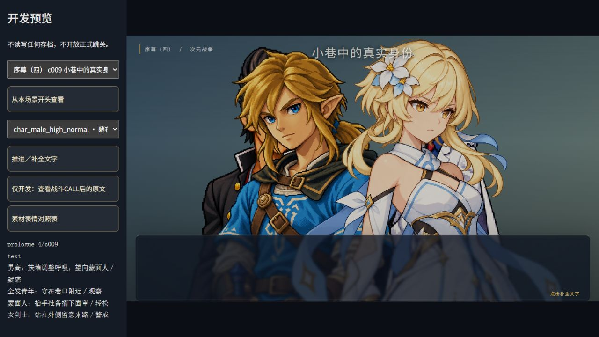
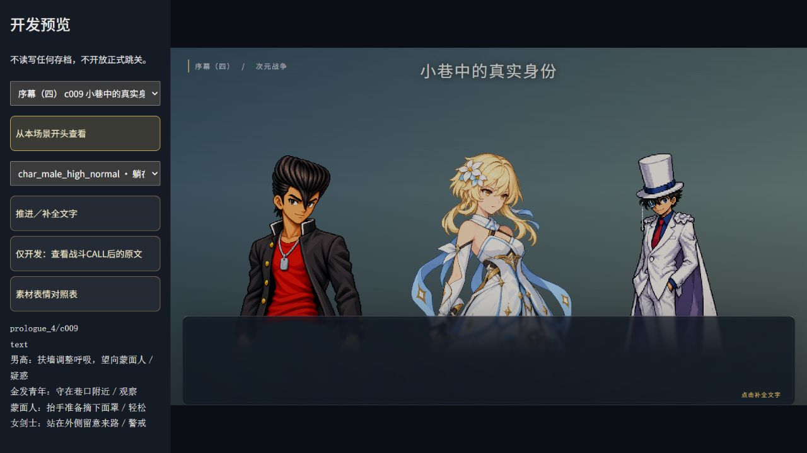
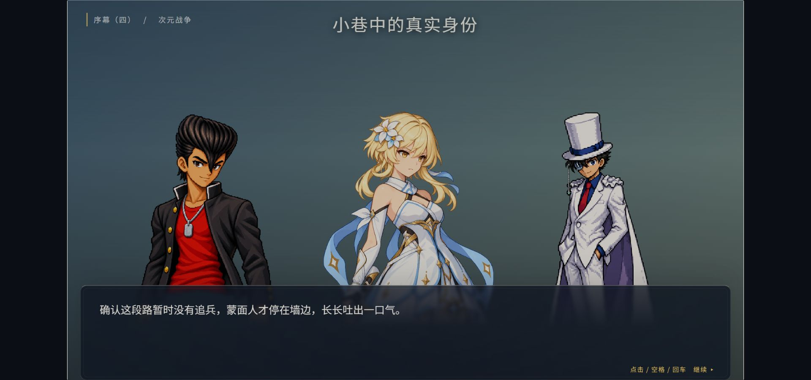
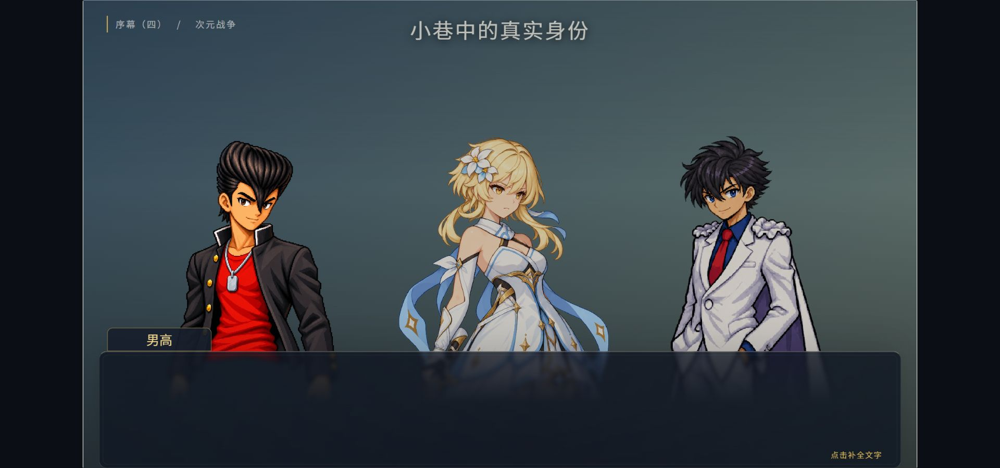
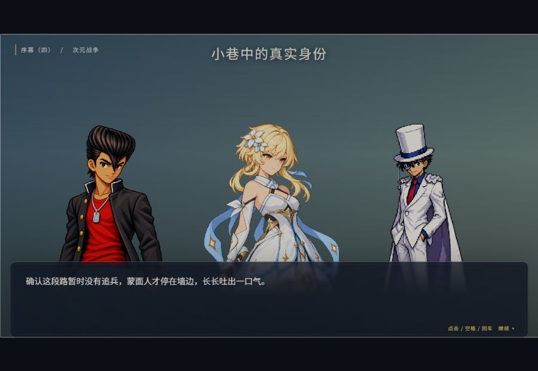
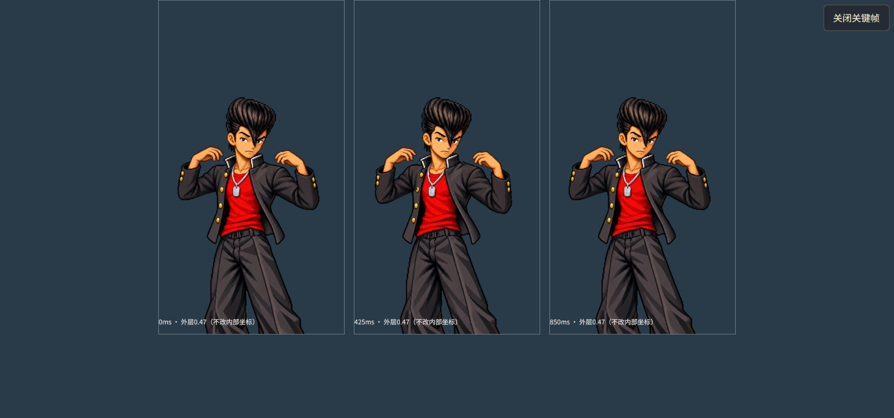
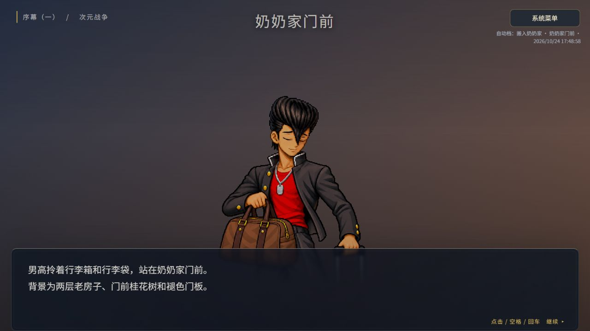

# 小半身、全局排位与三人显示 · 独立验收

2026-10-24。实施基线`3edb8cede4098780dd05910c0e19b201d0a720b3`，保留交接时五份说明修改、已选参考图、正式规格与提示词。跳过功能和另一窗口的润色剧情已在该基线；本轮不重新计作成果，不导出或改写剧情。

## 实际实现

- 保持1280×720逻辑画面及180px文字窗。显示中心为一人640、两人384／896、三人256／640／1024；同一造型不因人数、说话或表情改变大小。
- 人物最多三人，道具独立。原visible／position、SHOW／HIDE、身份、演出增量继承不改；纯展示转换读取实际已执行SHOW轨迹，update不算重新入场。C009–C012使用确认的原演员键优先名单。
- 正式对白的在场候补按最久未发言者换入，接替原槽，其余人不动；未发言者先被替换，同级按较低优先级、入场顺序稳定决定。旁白、心声、舞台、选项、场外及制作备注不强制换人；男高无常驻特权。
- 展示名单与发言历史集中在当前视图，绑定run／幕／场景，不入GameState、v4或设置。稳定实例、VisualLease与全套预解码保留；非展示者更新外观但停口型和多余调度。
- 先150ms淡出，再替换并淡入。旧scope／修订回调无效；菜单暂停、快进及恢复直接定格，不阻塞文本，不补播隐藏期间动作。离开释放过渡、实例与图层调度。
- 11组外层度量分别登记原坐标头部／主体基准、锚点、窗上安全轮廓。五动态scale0.47、头基准136.77px；透明男高半身0.28、141.4px；其他专用姿态保持专用素材。女剑士披风约129.36px头高、礼帽包含在行动形态头基准，非人形使用主体基准，均保留例外记录。
- 人物层为独立低层，标题、HUD、系统菜单、名字牌和选项在其上；窗后550–620px渐隐避免原图底边。32个静态素材／动作合成的窗上alpha≥128轮廓检查最大332.31px，没有超过340px。该统计只辅助人工复核，不把低alpha光晕或语义头部当作已经自动识别。

## 工程检查

开工实际36文件523项、typecheck通过。原523项断言及测试文件保留；新增43项名单／入场／身份／度量／过渡测试。

| 命令 | 实际结果 |
|---|---|
| `npm run typecheck` | 通过 |
| `npm test` | 38文件566项通过 |
| `npm run build` | 通过；94模块，`index-CTdcwfkp.js` |
| `npm run build -- --base /dimensional-war-game-source/` | 通过；`index-DJx5Vb64.js`、`index-TLRgB-2k.css` |

最后移除外层left插值，避免加载时换画布锚点产生短暂横移；人数变化允许直接重新定位，换人仍使用150ms顺序淡变。最终四命令原输出见[checks-final.txt](verification/portrait-layout/checks-final.txt)，前次检查保留在checks.txt。依赖、strict保持，无any及超过400行的代码；保护和逐文件结果见[after.json](verification/portrait-layout/after.json)、[file-changes.md](verification/portrait-layout/file-changes.md)。开工快照812项（含本轮先建后采集的核对脚本），排除该新增脚本、允许8个既有工程文件变更，其他803份快照哈希一致；包括source、全部剧情JSON、导出器、素材、旧测试、战斗／AI／存档／地图代码和历史验收。期间别窗独立提交a281953，仅新增online-polish-route.png，另按该提交原件核对并保留，不计本轮成果。工程外只同步已授权的`游戏机制/对话与动态立绘.md`，前后哈希另记external-doc.json。

## 浏览器实际范围

全部使用CUA真实按钮与键盘。开发origin43920；新档origin43922；正式base产物另以43923预览。没有清除或覆盖维护者正式存档。

- **正式素材／受控演出页**：C009初始三人为男高／女剑士／蒙面人，金发青年仍在场；沿原节点摘面罩后在同槽显示怪盗。C010、C012三人稳定；C011按原HIDE／SHOW由女剑士变Saber，未提前显示姓名。仓库P005四人在场但只绘三人；教室A004占位也参与相同排位。
- **受控第四人对白**：C012金发青年换入右槽，男高256及女剑士640不动，原剧情四人仍在场。此测试台词仅在开发夹具，不进入正式剧情。
- **男高素材**：五个已批准动态组合分别检查统一尺度；闭眼、说话嘴及准备动作0／425／850ms三关键帧留证。坐沙发、持剑、躺靠使用原专用图，不用站姿替代。没有制作或修改新美术。
- **动画与加载**：男高在场但不展示时口型false，经过其他工具工作后动画请求计数仍为1；候补更新为准备姿态，手臂旋转0deg。对白换入后使用最新准备配方，未补播准备动作。暂停关闭口型。连续延迟请求最终只落最后配方；单层失败回退静态，度量为hero-half／0.28，不将分层0.47套到大头图。诊断明确，旧回调不恢复移出人物。
- **实际视口**：浏览器viewport能力生效，DOM内innerWidth／innerHeight实测1920×900与900×620，stage分别1600×900和900×506.25；不是仅改截图尺寸或假称外窗。1280×720也留有同视口前后对照。等比画面原有留边保持，人物不挡标题／窗／菜单。
- **正常新档**：独立43922从三按钮主菜单、奶奶家卡片进入P001，真实Enter逐句到P002；先继承行李／紧张期待，再按原顺序更新放松微笑，scale仍0.47。返回地图、刷新、读取自动档恢复P002场景头及行李姿态。
- **真实控制器＋受控合法v4**：C009合法场景头经读取确认进入，ESC系统菜单置顶跳过，开关菜单写次数保持2。300ms快进跨C009–C013，最终真实END回9/9地图；不是新档完整九关，也不算战斗胜利。重新载入C009后名单重建，返回地图无人物DOM，保留C009检查点。受控A006→A007快进停在四选项，仅2启用，男高准备／疑惑继承；实际点主播进入A008并退场重排两人。

逐项DOM记录见[browser-layout.json](verification/portrait-layout/browser-layout.json)、[browser-runtime.json](verification/portrait-layout/browser-runtime.json)，轮廓结果见[opaque-bounds.json](verification/portrait-layout/opaque-bounds.json)。本轮观察的实验页、正式控制器和新档页控制台无error；既有缺图／未制作动作诊断继续保留。

## 关键截图

以下两张使用相同1280×720浏览器视口与同一开发预览边栏，可直接比较逻辑画面中的人物大小及遮挡。参考图没有冒充实装。

五组合分别见同目录hero-sample-0至4.jpg，专用姿态为hero-seated／sword／bed.jpg；菜单、A006／A007和回图另有截图。

## 边界、体验与发布

本轮没有重新从新档全通九关、没有重新实打或跳过两场真实战斗，也未逐项重做六手动槽／跨窗口竞争；这些保留523项回归，本次未改相应内核。受控异步失败不等于真实断网；没有以开发页的测试台词或直接场景选择冒充正式新档流程。既有静态素材自身光晕、复杂身体动作缺口继续保留，不把排位改造写成新美术制作。

本地`npm run dev -- --host 127.0.0.1 --port 43922 --strictPort`正常游玩；开发构图页`/tests/portrait-layout.html`仅开发可用、不入生产、不读写存档。正式base构建后`npm run preview -- --base /dimensional-war-game-source/ --host 127.0.0.1 --port 43923 --strictPort`，从对应子路径游玩。

正式base本地预览实际经新游戏／地图／首关进入P001，9张行李配方图片全部解码，人物scale0.47／center640。最终88个发布文件HTTP200且SHA逐一相同，见local-production-http-final.json；开发页与证据不在dist中。

## 文件与交接边界

新增程序：visual/entrances.ts、portrait-layout.ts、portrait-metrics.ts、display-transition.ts；新增测试：portrait-layout.test.ts、portrait-metrics.test.ts；新增开发夹具：tests/portrait-layout.html和src/tests/fixtures/portrait-layout-browser.ts；新增核对工具：tools/check-portrait-layout.mjs、measure-portrait-layout.py、verify-portrait-publish.mjs；新增本报告及verification/portrait-layout下逐项列出的截图、数据和命令记录。

修改程序仅src/game/ui/portraits.ts和src/styles/player.css；同步AGENTS、README、任务书、decisions、dialogue-presentation-spec、portrait-layout-spec以及已授权的工程外策划说明。接收并保留文档窗口已经新建的portrait-layout-spec、交接提示词和selected-reference.png，提交清单会包含这些已完成交接文件，不把它们重新算作本轮制作的新参考图。删除0；未提交服务日志、dist或无关临时文件。

按工程已确认流程在本地验收后正常提交推送现有main，核对Actions与真实Pages；发布回执在获得实际结果后追加，不预先宣称成功。不创建Sites，不改仓库可见性。

## 已获得的发布回执

- 正常提交并推送`c0d64e8d767461ab12a0c8e28821d49356f8e422`，在别窗a281953之后保留历史，无force或重置。
- [Actions 40083243754](https://github.com/yeklongdi/dimensional-war-game-source/actions/runs/40083243754)明确completed／success，build与deploy均成功；CI再次通过38文件566项及正式base构建，发布`index-DJx5Vb64.js`／`index-TLRgB-2k.css`。原JSON见release-build.json。
- [真实正式网址](https://yeklongdi.github.io/dimensional-war-game-source/)无需GitHub登录。88个发布文件HTTP200且SHA与本地逐一匹配，见online-http.json；没有上传测试页、证据、原稿或文档到dist。
- 实际浏览器主菜单显示无新版自动档，存在旧版本记录提示，按原新游戏确认流程仅新建v4验收进度，未载入或清理旧进度。经地图与首关卡片进入P001，男高行李紧张配方9图层全解码，center640／scale0.47／头基准136.77px；ESC菜单覆盖人物层，刷新读取仍从P001头开始，控制台无error。在线首次读取资源期间保留了显式占位，待实际解码后重新截图；没有把占位当作最终立绘通过。
- 线上实测仅覆盖入口、地图、P001、菜单和刷新读取，不声称在线全通九关、C009–C012或两战。正式域名和localhost存档隔离，不自动同步。
- 后续仅补交验收文档／截图回执，不再修改游戏代码；该回执提交与Actions编号在最终交付消息中给出，避免文档自引用提交号。

