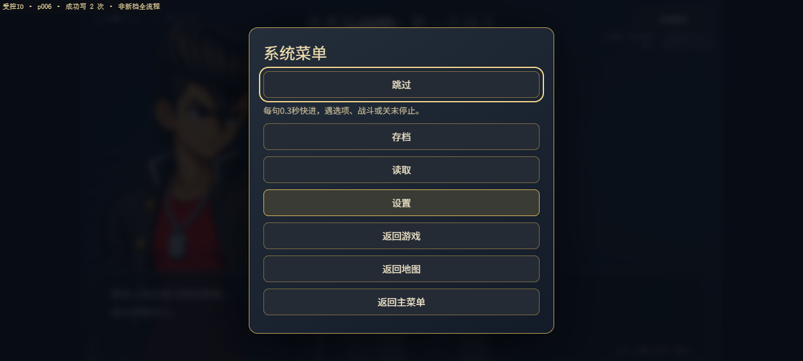
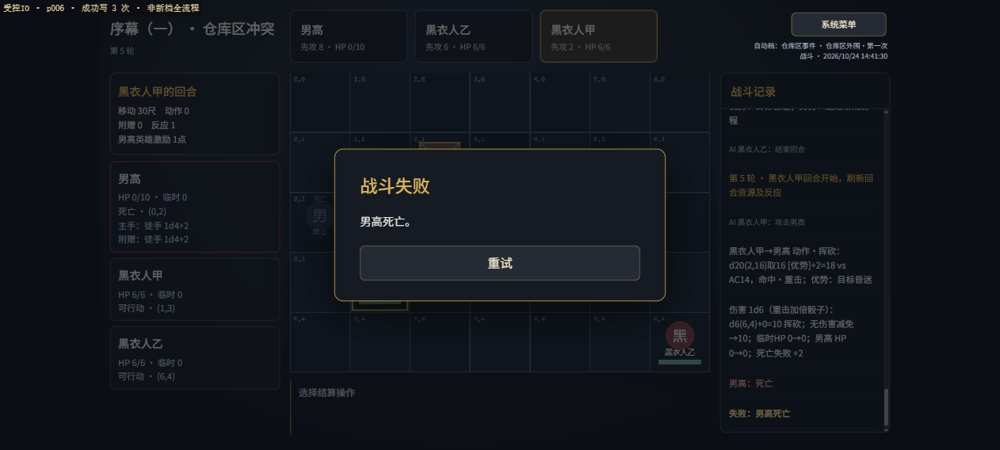

# ESC菜单、逐句快进与战斗跳过 · 独立验收

日期：2026-10-24。基线cdd13db，工作区干净。当前四段序幕48主场景、4未完成分支、九关，存档v4；本轮不沿用旧七关／v3假设。用户已确认300ms整句快进、失败可跳过、未制作两CALL可手动跳过、战后正常阅读。

## 自动检查与保护

- 开工实际typecheck及33文件490项通过。
- 本轮typecheck、36文件523项、根路径build及正式base build通过；原490项断言未修改。新增33项覆盖快进与停点、两战／失败／等待清理、两处CALL、第九关与保存门槛、旧回调。命令原输出见checks.txt。
- 正式base产物为index-TOV-zCU1.js、index-D_w9lRjR.css，共88个文件；dist不含开发测试页、原文、证据或文档。
- before.json登记776文件；允许变更清单外758文件SHA一致。source、全部剧情JSON、导出器、自动问题清单、美术、战斗内核／AI／数据、既有测试和历史验收不动。不运行导出。
- TS strict、三个固定开发依赖保持；无any、单代码文件不超过400行。最终详情见after.json及[file-changes.md](verification/skip-forward/file-changes.md)。

## 交付机制

ESC在剧情／正式战斗的捕获阶段开系统菜单，跳过首项；移动草稿保留。系统菜单仍暂停原自动推进，关闭不穿透。正文快进使用原reducer逐句推进，整句显完后等300ms；选择／战斗／关末等停点清除快进。停止操作只停止；失焦、隐藏、导航及外部运行切换清除，不自动重启。快进仅内存，设置与存档结构不变。

已实现战斗包括失败后，跳过共用正常胜利的CALL返回校验。CALL光标不额外加一，不硬跳，不额外掷骰、不清敌血、不伪造击败日志；原胜利flag与独立跳过flag明确记录。正常已胜利不加跳过标记。P006按新稿继续自动节点后到P007第一段；A014回战后四段和两个SET。

序幕四两处默认仍停等，只有系统菜单明确点击跳过才执行随后原文；仅两个配置CALL可用。C004／C005需巡逻跳过记录，C006–C013需两处；第九关完成还需C013原完成SET和END。历史标记不自动越过再次遇到的CALL。旧合法v4可读，v1／v2／v3只读保留、不迁移。

## 浏览器记录

隔离开发origin：127.0.0.1:43920；正式子路径预览：127.0.0.1:43921/dimensional-war-game-source/；门槛反向用例另起127.0.0.1:43922，用完即停。不清理维护者正式域名档，不注入GameState／血量／骰子或胜负。

新档真实流程使用正常地图地点、关卡卡片、ESC和跳过按钮；跳过战斗单独记录，不称实打胜利。过程见browser-route.json。受控检查点页tests/skip-forward.html使用合法场景头v4与替换IO；不接触真实localStorage，状态由真实控制器创建，其结果不能冒充从新档游玩。

### 新档全流程（28步）

ESC置顶菜单、停止不续跑、教学战前停点、两战跳过、A007四选项（仅主播分支启用、跳过在该等待禁用）、A010手动选择、A014战后四段与两SET、六、七、八关完成、C003默认阻断与明确跳过、刷新回场景头、历史标记不自动越过、C005二次CALL、C013原END后九关完成、完成关卡片禁用、完成自动档刷新读取。过程与页面状态见browser-route.json。

### 受控检查点与真实失败（8步）

从合法p006场景头读档，正文与写次数正确；ESC菜单跳过置顶；点快进在真实战斗前停住。随后每回合只结束回合、不攻击，敌方AI自行进攻，第5轮男高HP0进入昏迷，被重击后死亡豁免失败累计达到“失败：男高死亡／战斗失败”——整个败北由真实战斗产生，未改血量或胜负。失败界面ESC仍可跳过，提示“跳过本场战斗，按胜利继续原剧情”，跳过后回到P007第一句“几个黑衣人倒在地上…”，won与skipped两个flag同时记录、检查点为P007、关卡仍未完成，旧v1／v2／v3原串不变。步骤与逐项观测见controlled-route.json与controlled-failure.txt。

门槛反向用例：在独立origin手写v4自动档，检查点放在c004但不带巡逻跳过记录，主菜单报“自动档损坏；有效手动槽仍可读取，原槽未覆盖”，原串revision与时间戳保持原值；仅补`flag_battle_prologue4_patrol_skipped`后同一串即被识别为“警报下的同行者·第一名干部到场”。即拒绝原因是缺少明确跳过记录，不是串格式坏。

## 体验、发布与边界

执行npm run dev后从终端地址体验；生产预览先build --base /dimensional-war-game-source/，再preview --base /dimensional-war-game-source/ --host 127.0.0.1 --port 43921 --strictPort。

正式站沿用https://yeklongdi.github.io/dimensional-war-game-source/，main正常提交推送，检查Actions与真实产物后才记录成功。不创建Sites或其他平台，不修改仓库可见性。正式旧档只检查不覆盖，不用于演示跳过。

当前剩余浏览器与发布结果待追加；本段不预先宣称部署成功。
