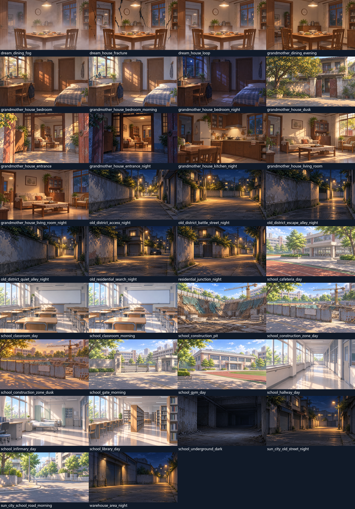
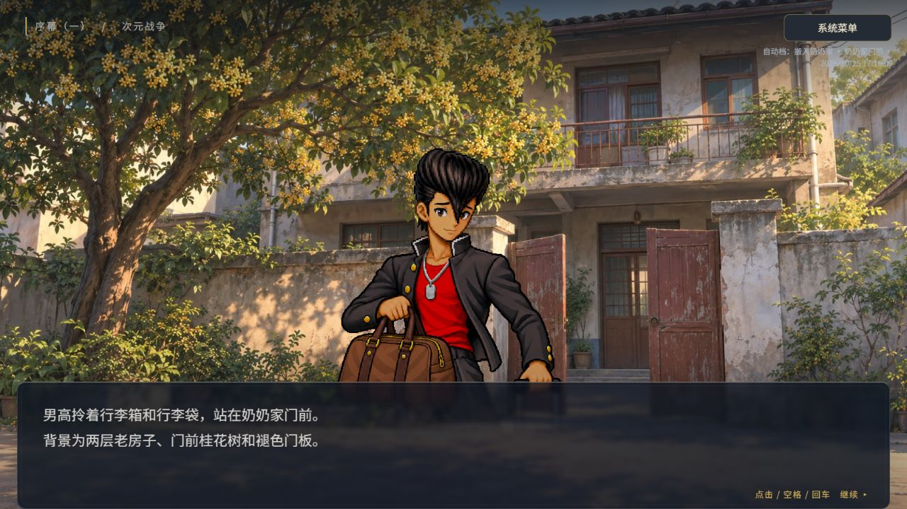
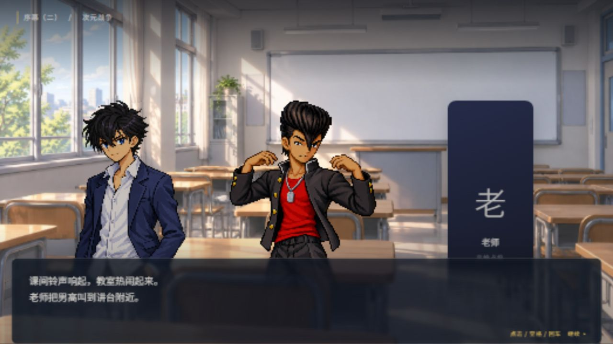

# 手绘背景整套制作、接入与发布验收

日期：2026-10-25。范围：四段序幕、九关、dw.save.v4。三样张用户已批准，本轮继续实际绘图、背景绑定与现有GitHub Pages发布。

## 本轮结果

- 保留三张批准裁切原件及其SHA；新增内置image_gen绘图31张。共34张独立WebP覆盖36个原背景键，52场景和63个BACKGROUND不改。
- 显式复用仅两组：`bg_grandmother_bedroom_night`使用`bg_grandmother_house_bedroom_night`，`bg_grandmother_living_room_night`使用`bg_grandmother_house_living_room_night`。其余32键分别有独立图。
- 运行图均1664×936、精确16:9；不放大批准图。原始输出与裁切母版保留，运行图总11605802字节，最大606824字节，单图均低于1MiB。
- 住宅、卧室、教室、施工区及梦境按同结构母版生成差分。三图属于用户明确批准，其余图仅称“按批准方案制作／执行窗口自检”，不冒称用户逐图审过。
- 实际来源、完整提示词、参考用途、真实工具输出、适用场景、尺寸和SHA见[制作记录](../素材制作/场景背景生成记录.md)和[资产清单](verification/backgrounds-v1/integration/assets.json)。

## 正式接入

`src/game/story/backgrounds.ts`独立绑定36键，经现有assetBindings／assetUrl处理BASE_URL。PlayerView使用BackgroundView及BackgroundLoader，真实加载并解码当前图片；不一次下载全部母版，缓存仅当前视图访问过的运行图。

更换地点时立即显示当前场景渐变和场景标题，解码完成才交付图像。404或解码失败回退当前渐变，同显示实例每键一次诊断；新场景／重建可重试。run、幕、场景、背景键与视图租期共同拒绝旧成功和旧失败；释放后回调无效。诊断不推进正文、不改flags／RNG／存档。

仅背景层使用平滑采样。顶部遮罩提高亮窗后的HUD对比；批准母版、人物尺度／三人排位、名字框、按钮及180px文字窗不改。

## 工程检查（本轮实际运行）

| 命令 | 结果 |
|---|---|
| npm run typecheck | 通过 |
| npm test | 41文件、591项通过，失败0 |
| npm run build | 通过，97模块 |
| npm run build -- --base /dimensional-war-game-source/ | 通过，97模块 |

完整输出见[检查日志](verification/backgrounds-v1/integration/engineering-checks.txt)。本轮新增22项，保留原569项及原测试断言；未新增运行时或开发依赖。测试守背景键覆盖、批准哈希、真实文件、base、异步回退／失效和原七组场内顺序。

## 真实浏览器：只按实际覆盖报告

用户中途进一步要求“只需要验证背景是否可以显示，其他的不需要”。后续收敛为背景资源与显示，不再追加完整通关、战斗或存档专项。

- 开发origin：`http://127.0.0.1:43931/`，与正式域名隔离。正常菜单→新档→地图地点→首关，以真实键盘走P001–P004，观察门前、进门、客厅、卧室→厨房，关末回地图。后续仓库战使用既有明确跳过，不称实打胜利；停止额外流程验收。
- 独立开发页：`/tests/backgrounds.html`，复用真实PlayerView、立绘和解码器，无存档／音频控制器，受控场景头不冒充正式新档。全部34图实际浏览器解码成功。
- 住宅、教室、校园导览、施工区／坑底、正常饭桌／雾／循环门／破裂、夜街和夜归均实际加载显示；一人、多人及C009–C012三人按原排位检查，未为背景改人物尺寸。
- 1280×720逻辑画面、1920×900及900×620实际视口已留图。部分快速切换截图会包含加载或人物过渡帧；稳定显示证据优先看`production-base-p001.png`、`final-display-classroom.png`及正常游戏截图。
- 正常背景显示未观察到新增控制台error。故障页主动请求不存在图片产生一条预期404；真实非图片文件触发解码失败。二者与正常资源问题分开登记，未隐藏诊断。

| 原场内顺序 | 浏览器观察 |
|---|---|
| P004 卧室→厨房 | 一致，正常新档及开发页均见 |
| P009 卧室夜→学校地下 | 一致，开发页 |
| A008 图书馆→食堂外→体育馆外 | 一致，开发页 |
| B006 循环梦境→卧室→循环梦境 | 一致，开发页 |
| C001 卧室→搜捕街口→卧室 | 一致，开发页 |
| C008 对峙街→撤离背巷 | 一致，开发页 |
| C013 门口夜→客厅夜→卧室夜 | 一致，开发页 |

加载专项实际检查：等待期间不显示旧地点；旧成功晚到不覆盖新图；真实404／解码失败恢复渐变；重建后恢复加载；旧失败晚到不污染当前背景；旧视图释放后请求无效。结果见[浏览器开发证据](verification/backgrounds-v1/integration/browser-dev.json)及[正常入口／子路径证据](verification/backgrounds-v1/integration/browser-game.json)。

## 子路径、保护与文件清单

本地生产预览使用`vite preview --base /dimensional-war-game-source/`，端口43933；先前不带base的预览配置不用于验收结论。P001实际图片URL含正式前缀，34张资源均HTTP成功、真实解码并与本地WebP SHA一致，见[本地资源核验](verification/backgrounds-v1/integration/resources-local.json)。默认dist不含art母版、开发测试页、说明、原稿或验收截图。

source、剧情JSON、导出器、自动问题清单、原批准立绘、三张样张及历史验收保持原字节。前后保护与逐文件增改删清单见[保护记录](verification/backgrounds-v1/integration/protection.json)。工作区开工已有文档和样张成果保留并纳入本任务发布，排除本机日志、依赖、dist与缓存。

## 发布回执

正式网址：https://yeklongdi.github.io/dimensional-war-game-source/

发布状态在获得对应提交的Actions build／deploy及正式资源检查后补记。当前本记录不把本地通过或推送排队称为已上线。

## 剩余镜头限制

- A003正文中的走廊／地下没有BACKGROUND；A011从外围到坑底的场内过程也没有单独指令。保持原指令，不按文字或CAMERA/meta自动切图。
- 关灯、剑发光、临时被褥及其他未有背景节点的状态没有新增差分切换；剑、黑色结晶等继续由原SHOW／既有占位承担。
- 4个未完成路线仍未开放，只复用已绑定教室。不把背景覆盖称为新增CG、相机演出、战斗或完整九关新验收。
