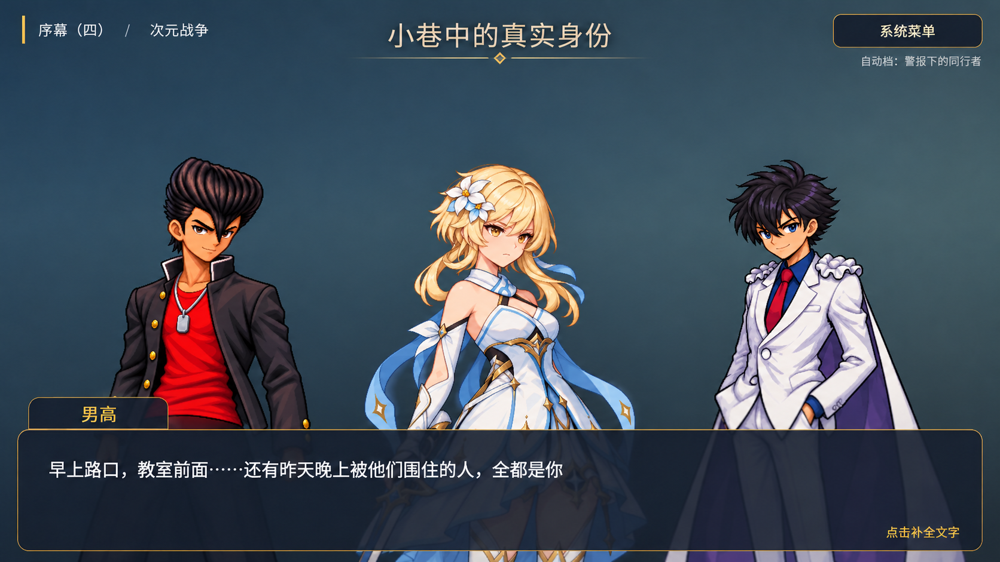

# 对话立绘：小半身构图与三人显示规格

2026-10-24用户确认，随后实施窗口完成。**状态：游戏小半身、最多三人和在场对白换入已实装，通过本轮工程检查及隔离浏览器复核。** 文档阶段来源保留；实际截图、范围和发布回执见[独立验收](portrait-layout-verification.md)。

本规格替代旧演出规格中的768×1152固定显示尺寸、同槽320px偏移及所有在场人物同时绘制规则。底部文字窗、素材批准、原生分层、剧情语义和保存规则继续适用。内容范围是当前四段序幕、九关；存档保持`dw.save.v4`与`prologue_four_parts_v1`。

## 1. 已确认的视觉方向与参考

用户比较两张示意图后选择第2张，并确认：最多三人、人物轮廓尽量分开；一人、两人也保持同样大小；多人场景先固定三人，未显示的在场人物发言时换入。

- 参考图仅说明人物大小、间距与背景留白，不是游戏实装截图，也不是新角色素材、服装或表情批准。
- 参考图由本轮内置绘图工具生成，原文件名为`exec-8160c08a-77c4-4453-a2ae-d99690cc595d.png`；本副本按原字节复制。
- SHA-256：`1c0fdf9983b985881732ee544cc0c7e090fd3df7ace1004cad5f7bbe35af6d4a`。
- 《千恋＊万花》仅提供公开构图参考。此前REA没有确认其内部排位算法；下述规则是本项目的设计，不使用原作资源，不补写原作技术事实。证据边界见[研究说明](senrenbanka-presentation-study.md)。

## 2. 尺寸、排位与界面层级

保持1280×720逻辑画面和现有底部180px文字窗。窗口尺寸变化继续整体等比缩放，不另建一套小窗口坐标。

| 展示人数 | 横向中心，逻辑像素 |
|---|---|
| 0 | 不绘制人物；保留背景与正文 |
| 1 | 640 |
| 2 | 384、896 |
| 3 | 256、640、1024 |

这些是显示层坐标。原`ActorState.position`不改写；原方位用于初始左右顺序和后景语义，不再直接套用旧五槽中心及同槽偏移。同等方位按场景优先名单、实际入场顺序稳定排序。人数变化可以重新排位；仅说话或表情变化不得重排其余人物。

普通站姿以选定图为基准：头顶大致在逻辑y=200～220，头部可见高度大致130～150px。示意图不是精确坐标图，这些值是校准起点，最终须使用正式素材截图核对比例。

- 一人、两人、三人共用同一造型的显示尺度；不随人数、说话者或逐字进度放大。
- 文字窗上方的单人轮廓安全范围原则上不超过340px宽；相邻人物轮廓至少留24px间隙。须把披风、头发、手臂及已批准动画最大活动范围纳入检查。
- 为同一造型预留动画余量，不逐帧改变缩放来躲避碰撞。同一造型的表情差分共用度量，避免换表情跳位。
- 完整头部与可辨认面部优先。特殊宽姿态先以等比缩放满足轮廓间隔；确实需要偏离普通站姿头部目标时，在验收中逐项记录，不通过裁掉脸、拉伸人物或改图遮掩。
- 下部自然延伸到文字窗后和画面外，不露出悬空底边。坐姿、持剑、躺靠保留已有专用姿态，分别校准，不用站姿替代。
- 占位角色保留明确色块、首字与名字，适配同样的排位与安全范围；不借本轮制作其新形象。
- 人物层整体低于标题、系统菜单、名字牌、正文窗和选项；说话者增亮／升层只在人物层内部生效，不放大、不加金边。

## 3. 素材度量与显示接口

半身、全身、分层图的透明边距及人物占比不同，不能统一按原画布高度缩放。新增只供显示使用的度量配置，至少描述：原素材坐标中的头部基准、人物轮廓安全范围、定位锚点和造型分组。

- 普通人物按实际头部大小对齐；非人形素材可使用明确的主体基准，不伪造人类头部坐标。
- 同一造型的差分共享基准；不同姿态允许独立校准。分层动画的安全范围包含全部已交付帧与动作极值。
- 原素材、1024×1536等原画布、图层注册偏移和关节参数保持原样。显示定位／等比缩放放在外层，图层内部动作继续使用原坐标，避免重复缩放。
- `resolveVisual`继续负责已批准素材及layered／static／placeholder回退；排位层只读取其结果，不按对白推断情绪或改选姿态。
- 展示规划使用纯转换：输入在场演员、场景优先配置、当前正式对白及上一份临时展示状态，输出展示名单、槽位和外层变换。不得修改传入的游戏状态。
- 展示状态由当前视图集中持有，绑定`run + actId + sceneId`；不是第二份游玩状态，不增加存档字段，也不使用散落的全局变量。
- 既有`SHOW/HIDE`、`show.update`、`asset/pose/expression/position/visible`和剧情JSON接口不变。道具继续由独立图层处理，不占三个人物名额。

## 4. 展示名单与换入

### 4.1 两种可见性

“剧情在场”仍由原播放器的`SHOW/HIDE`与跨场景继承决定；“当前画面展示”是演出层的临时选择。有效绘制及动画可见性是两者同时成立。

暂未绘出的人保留最新素材、姿态、表情和原方位。不得为减少同屏人数写回`ActorState.visible`、执行额外HIDE、删除演员或改动原剧本。

### 4.2 初始化、补位与替换

1. 每场从优先名单中筛选已经在场的人，最多三人；名单未列出的候选按实际入场顺序补足。无专用名单时直接使用实际入场顺序。不能把旧演员对象的枚举顺序当作本场重新SHOW的顺序。
2. `SHOW.update`只更新外观，不重新登记入场、不改变优先级。跨场景继承继续有效；新场景重建本场展示名单和发言记录。
3. 未展示人物新SHOW时，有空位才补入；已经满员时不无故挤走现有人物。HIDE移出后，从仍在场的候选按同一优先规则补位；无候选则减少人数并按第2节排位。
4. 当前正文是正式`dialogue`，且说话者已在场但未展示时换入。没有SHOW的场外声音不自动出现；旁白、舞台说明、心声不强制换人。
5. 替换三人中最久未发言的一位；从未发言者先替换，同级时选场景优先级较低者，再按入场顺序稳定打破平局。发言按正文节点计一次，逐字刷新不反复登记。
6. 新角色继承被替换者的槽位；其余两人不移动、不缩放。换入后保持名单，不在下一句自动换回。男高没有额外常驻特权。
7. 选项等待及非正文等待保持已有展示，除非原SHOW/HIDE改变了在场演员。制作备注不参与发言次序或换人。

### 4.3 序幕四专用配置

| 场景 | 优先显示，之后为候补 |
|---|---|
| `prologue_4/c009` | 男高、女剑士、原文当前身份的蒙面人／怪盗；金发青年候补 |
| `prologue_4/c010` | 男高、女剑士、怪盗；金发青年候补 |
| `prologue_4/c011` | 男高、原文当前身份的女剑士／Saber、怪盗；金发青年候补 |
| `prologue_4/c012` | 男高、女剑士、怪盗；金发青年候补 |

“蒙面人／怪盗”“女剑士／Saber”表示原文先后身份，配置须使用原演员键并按当前在场状态过滤；不是新演员名，也不授权自动合并身份。遵循原HIDE/SHOW，不同时占两个名额、不提前显示姓名或服装。金发青年暂未绘出不代表离开剧情。

## 5. 实例、动画、过渡与恢复

- 按演员键复用现有实例、`VisualLease`及整套解码后的原子替换。逐字、换人、换表情不重建无关身体或重复加载同一图片。
- 未展示人物仍接收最新外观状态，但停止口型和不必要的动画调度。换入时使用最新外观，不补播隐藏期间已经发生的准备动作。
- 换位采用约150ms淡出后再淡入，同一槽位不同时叠放两个实体人物。过渡中的暂时透明不算人数变化，不触发其余两人重排。若新素材尚未就绪，沿用既有明确占位和失败回退，不能让过期人物挡住新说话者。
- 过渡只属于视图，可被新换人、快进、读取、运行失效或导航取消；旧完成回调须同时校验会话和展示修订号。过渡不阻塞文字，不触发额外剧情推进。
- 系统菜单期间遵循现有暂停／口型门控；不会因菜单或过期加载回调重新显示已经移出的角色。离开剧情释放动画、计时器、观察器和异步租期。
- 从场景开头恢复时按相同规则重建名单；不保存发言历史、展示名单、槽位动画或帧号。flags、剧情指针、RNG、战斗资源和保存次数不受排位影响。

## 6. 实装窗口的验收要求

当前文档窗口没有运行本节的程序验收，不把参考图当作游戏截图。实装后新增独立验收记录，保留历史验收原文。

### 6.1 自动检查

- 0／1／2／3／4人以上、原方位排序、稳定平局及一人两人尺度不变。
- 正式对白换入、最久未发言替换、HIDE补位、不自动换回；逐字更新不重复登记或重播过渡。
- 旁白、心声、场外声音、制作备注、选项和道具不错误触发换人。
- `SHOW.update`、场景继承、身份揭示、占位、静态回退及分层图度量。
- 相同输入及临时展示状态产生相同输出；游戏状态不被修改，无RNG／保存副作用。
- 隐藏人物最新表情、口型停用、外观租期和过期过渡失效；恢复不补播动作。
- 保留当前适用的剧情、九关、两场真实战斗、六槽、设置及快进／跳过回归。不要引用旧测试数量作为本轮结果。

执行`npm run typecheck && npm test && npm run build`，再执行`npm run build -- --base /dimensional-war-game-source/`。

### 6.2 浏览器与视觉复核

- C009–C012：三人轮廓、脸部、身份时机、换入槽位和顶部UI。
- 原仓库区与教室多人：同槽、不同槽、占位和候补都符合三人限制。
- 男高五个动态组合及坐姿／持剑／躺靠：等比例、动画极值、专用素材及下部裁切正确。
- 普通推进、300ms快进、菜单暂停、跨场景、读档、快速换人及异步失败。
- 1280×720逻辑画面、1920×900及900×620实际内容视口；记录实际窗口方式，不以单测代替截图。
- 使用隔离验收存储，不覆盖维护者正式进度。实打胜利、跳过、受控检查点和正常新档分别报告。

## 7. 交接与本轮边界

[主窗完整提示词](../交接提示词/立绘构图与三人显示.md)可直接复制给实施窗口。正式代码、运行素材、源稿、剧情JSON、导出器、自动问题清单和存档格式均不在本次文档窗口修改范围。

本轮只新增规格、参考图及提示词，同步策划说明、原演出规格、任务书、README、决策日志和AGENTS；不提交、推送或部署。实装后的测试、浏览器截图及发布结论由实施窗口按当时授权独立记录，不能把本文档确认记作程序验收通过。

## 8. 实装补记（实施窗口）

- `visual/entrances.ts`只扫描已经走过的SHOW及当前分支前缀，沿用现有开放主线的演出恢复选项；不运行SET／CALL／正文。非update的重新SHOW重新排到入场序列末尾，update不重新入场。独立素材实验页没有脚本轨迹时使用稳定演员键作为实验输入，正式场景不靠对象枚举。
- `planPortraits`纯转换管理scope、slots和正文节点发言时序；状态集中在PortraitsView，不写GameState、v4或设置。人数不变时不因表情／原方位差量重排；候补接替受替换者的槽，HIDE无候补才减员重排。
- `portrait-metrics.ts`分为分层男高、透明半身、躺靠、坐姿、持剑、金发青年、女剑士、怪盗日常／蒙面行动／露脸行动及非人形11组。外层scale与头顶210对齐，五个分层组合共用0.47；静态按对应构图独立等比。女剑士披风宽姿态头基准约129px，礼帽计入蒙面头部，非人形使用主体基准，均明确记录。
- `DisplayTransition`先150ms淡出，再替换并150ms淡入。scope或修订失效即取消；菜单暂停／快进直接定格到最新名单，不留下旧过渡。Portrait实例和VisualLease保留，异步只更新外观，不修改展示名单。
- 窗上轮廓度量含动画余量，32个实际素材／动作合成的alpha≥128检查最大332.31px；具体视觉仍以截图复核。人物层整体在UI下，窗后550–620逻辑像素渐隐，避免透明底窗后露出原图底边。原PNG、图层注册和关节参数保持原样。
- 本轮38文件566项、四个工程命令通过；浏览器新档／受控、实际尺寸、失败回退及未覆盖项见独立验收。第7节的“只文档”描述保留文档窗口当时职责，不再代表当前代码状态。
