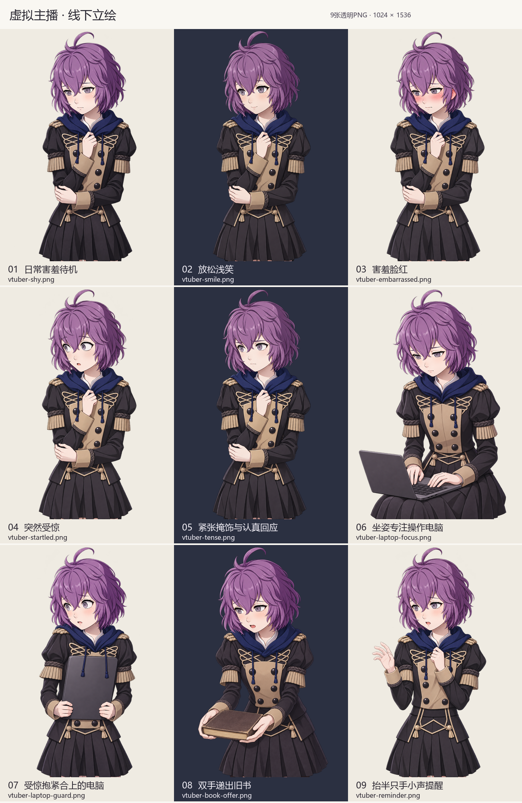

# 虚拟主播线下立绘：素材与游戏接入

2026-11-16，按用户提供的四张参考图，使用内置 `image_gen` 绘制。首批 9 张独立静态半身 PNG 为 1024×1536；用户随后要求补画趴伏、昏迷和病床苏醒，新增 3 张 1536×1024 横向专用立绘，共 12 张 RGBA 透明图。参考图与生成图按原字节保存，保留绘图工具的 alpha。

当前状态：**12 张图已接入 `char_virtual_streamer_shy`，通过定向测试、实际播放器显示检查及两种路径构建。** 覆盖日常表情、羁绊一 V101 动作及序幕（二）趴伏、昏迷、病床苏醒。V102 线上皮套尚未设计，本批不替代线上形象。实际范围见[接入验收](../工程/vtuber-portraits-verification.md)。

## 素材与场景对应

下表是接入建议，不修改既有剧情、脚本或状态变量。

| 文件 | 画面内容 | 对应使用 |
|---|---|---|
| [vtuber-shy.png](../../次元战争代码/public/assets/portraits/vtuber-v1/vtuber-shy.png) | 日常害羞待机，握住领巾、支住前臂 | 日常见面、轻声回应；本批外观母版 |
| [vtuber-smile.png](../../次元战争代码/public/assets/portraits/vtuber-v1/vtuber-smile.png) | 放松后的克制浅笑 | 对话稍微熟悉、安心回应 |
| [vtuber-embarrassed.png](../../次元战争代码/public/assets/portraits/vtuber-v1/vtuber-embarrassed.png) | 脸颊与耳朵泛红，视线躲闪 | 被夸奖、害羞 |
| [vtuber-startled.png](../../次元战争代码/public/assets/portraits/vtuber-v1/vtuber-startled.png) | 睁大眼睛、轻声惊呼 | 突然受惊的通用表情 |
| [vtuber-tense.png](../../次元战争代码/public/assets/portraits/vtuber-v1/vtuber-tense.png) | 认真注视、抿嘴、紧绷掩饰 | V101 听见“圣杯战争”后的回应 |
| [vtuber-laptop-focus.png](../../次元战争代码/public/assets/portraits/vtuber-v1/vtuber-laptop-focus.png) | 坐姿低头操作打开的笔记本 | V101 图书馆初见时的专注状态 |
| [vtuber-laptop-guard.png](../../次元战争代码/public/assets/portraits/vtuber-v1/vtuber-laptop-guard.png) | 缩肩并双手护住合上的电脑 | V101 受惊后、小心试探地回应男高 |
| [vtuber-book-offer.png](../../次元战争代码/public/assets/portraits/vtuber-v1/vtuber-book-offer.png) | 双手递出泛黄旧书 | V101 用地方志转移话题、递书 |
| [vtuber-reminder.png](../../次元战争代码/public/assets/portraits/vtuber-v1/vtuber-reminder.png) | 抬半只手、小声开口 | V101 结尾提醒男高办理借阅 |
| [vtuber-pit-collapse.png](../../次元战争代码/public/assets/portraits/vtuber-v1/vtuber-pit-collapse.png) | 趴伏、双臂吃力支撑 | A013 趴在坑边、即将失去意识 |
| [vtuber-unconscious.png](../../次元战争代码/public/assets/portraits/vtuber-v1/vtuber-unconscious.png) | 闭眼、无力侧躺 | A014、A015 昏迷状态 |
| [vtuber-bed-awake.png](../../次元战争代码/public/assets/portraits/vtuber-v1/vtuber-bed-awake.png) | 靠枕、攥被角、疲惫睁眼 | A015_RECOVERY 病床苏醒 |

## 接入注意

- 前五张属于同一站姿表情组，共用同一母版构图。alpha≥128 的轮廓边界相对母版最大偏差为原图 6 像素；这是轮廓检查结果，不代表图像逐像素一致，也不代替游戏内切换检查。
- 七张动作图采用独立姿态度量。普通和道具姿态头顶逻辑 y=210；三张横向低姿态头顶为 y=330，使人物下沿进入底部文字窗，保留趴伏／躺姿。均等比缩放，头高约139～141px，窗上安全宽度不超过340px，一至三人时大小相同。
- 电脑与书已经绘入各自专用动作图。调用这些动作图时，需要避免再次叠加同一道具。
- 本批为静态立绘，没有分离眨眼、口型和身体图层。受惊、点头、合盖、递书等过程尚无逐帧动画；动作图仅表示其中的一个静态状态。完整行走和男高横抱两人的联合动作仍未制作，保留相应静态代演诊断。
- 图片下沿是半身裁切边，显示时应自然延伸到文字窗后。保持等比缩放和完整头部、手部，不修改原 PNG 来适配排位。
- 既有资源键 `char_virtual_streamer_shy` 已绑定。只匹配脚本明确的姿态与表情，专用姿态优先于继承的表情，不按对白猜测情绪。剧情原稿、`source/`、剧情 JSON、游戏规则与素材许可均未改动。

## 生成与检查记录

- [完整生成提示词](../../次元战争代码/art/vtuber-v1/prompts.json)：记录 12 张成图的提示词及母版引用，使用内置工具，未使用 CLI/API 生图脚本。
- [素材登记](../../次元战争代码/art/vtuber-v1/registration.json)：记录文件、生成来源、尺寸、分组、SHA-256、alpha 范围、主体轮廓和未绑定状态。
- [素材检查结果](../工程/verification/vtuber-v1/asset-checks.json)：9 张通过，0 张失败；检查 PNG 解码、RGBA、1024×1536、真正透明背景、主体不透明度、透明角点、头发和手部道具的左右边界，以及与生成原件字节一致性。4 张参考图副本也与附件原件一致。
- [浅色／深色底透明度预览](../工程/verification/vtuber-v1/base-alpha-preview.png)与[九张总览](../工程/verification/vtuber-v1/contact-sheet.png)：仅供看图与检查，不是游戏运行截图。预览由原图合成，不反向修改立绘原件。

后续[12 张素材检查](../工程/verification/vtuber-v1/asset-checks-all.json)与[实际播放器检查](../工程/verification/vtuber-v1/runtime/browser-checks.json)记录本次接入结果；[补充姿态预览](../工程/verification/vtuber-v1/supplement-preview.png)展示新增三张。上述首批 9 张检查结果保留生成阶段原记录。

本轮只运行立绘相关定向测试，没有重测无关玩法。GitHub 发布由现有 main 分支工作流触发。

## 首批生成阶段文件清单

首批生成阶段新增 19 个项目内文件如下。后续补图、代码接入和验证文件见[接入验收](../工程/vtuber-portraits-verification.md)。绘图工具默认目录中的生成原件继续保留。

- 9 张 PNG：上表列出的 `次元战争代码/public/assets/portraits/vtuber-v1/` 中全部文件。
- 4 张参考副本：`次元战争代码/art/vtuber-v1/references/reference-01.jpg`、`reference-02.jpg`、`reference-03.jpg`、`reference-04.jpg`。
- 2 份 JSON：`次元战争代码/art/vtuber-v1/prompts.json`、`registration.json`。
- 1 份使用说明：`游戏说明/素材制作/虚拟主播立绘使用说明.md`。
- 3 份检查资料：`游戏说明/工程/verification/vtuber-v1/base-alpha-preview.png`、`contact-sheet.png`、`asset-checks.json`。

